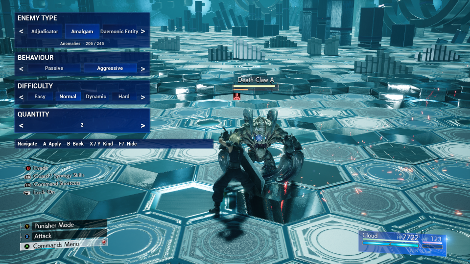
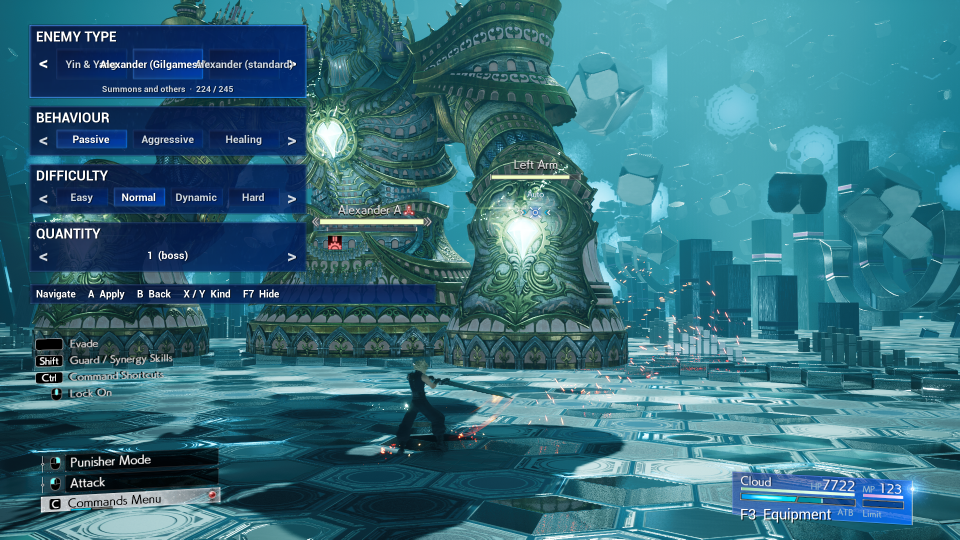

# Custom Training (workstream `custom-training`)

A course in Chadley's combat simulator where the player picks the opponent (one, two or three copies), Passive or
Aggressive behaviour and the difficulty, and changes any of them from inside the course without restarting it.

Marks: ✅ seen in game · 🟡 partly · ❌ tried and failed · 📖 read from game data or code, not yet tried.

## What this workstream owns

| Kind | Name |
| --- | --- |
| UE4SS mod (development) | `ue4ss/SimOverhaulCustomTraining/` |
| Pak (development) | `SimOverhaulCustomTraining_9200_P` |
| Specs | `data/custom-training.json`, `data/custom-training/` (and applies `data/party.json` from `party`) |
| Tools, tests | `tools/custom-training/`, `tests/custom-training/` |
| Tables replaced | `Colosseum`, `EnemyTerritory`, `ColosseumPositionData` (and `EnemyTerritoryLevel`, `EnemyParameter` if needed) |
| Rows | course `COL99_SimOverhaul_CT_Custom_vr` (probe: `COL99_SimOverhaul_CT_Probe_vr`), position `POS_Mod_SimOverhaul_CT_010`, repurposed territory `terVR_COL30_Gen_00_010` |
| Course timer slot | `TimerSaveArrayIndex` 192 (not used by vanilla, Training Dummy or Junon Colosseum) |
| Native helper | `native/custom-training/` → `ue4ss/SimOverhaulCustomTraining/dlls/main.dll` (UE4SS 3.0.1 C++ mod in the same folder, as Simulator Stages ships its helper) |
| Keys | F7 in the course shows or hides the settings panel (`ct_menu_key` in `settings.txt`); on a pad, LB+RB in a fight opens it |
| Settings | `settings.txt`: `ct_opponent`, `ct_count`, `ct_behaviour`, `ct_difficulty`, `ct_menu_key`, `ct_auto` (testing only) |

## How it works

1. **The course** (`data/custom-training.json`): one round in the repurposed territory `terVR_COL30_Gen_00_010`,
   cloned from the first Grasslands course, on the Combat Training tab, named by the Lua from its own text keys
   (Training Dummy's way). Its territory row (`data/custom-training/generated.json`, from
   `tools/custom-training/make_spec.py`) opens with one copy of the first opponent and ships 16 reinforcement waves:
   the first 16 opponents, at their levels.
2. **Finding the waves**: when the course starts, the Lua asks the native helper to look for that row in the loaded
   table by the exact contents of its 16 wave templates (FName comparison indices) and levels. The helper searches the
   game's committed read/write memory on a background thread, once per game session, and keeps the two addresses.
3. **Spawning an opponent**: the Lua writes the opponent's template and level into its spawn slot (the first slot its
   own scripts don't use), and the adds its scripts start into theirs (the Tonberry King's crown and minions, Phoenix's
   eggs, the Mindflayer's avatar…, taken from its vanilla round), then starts that wave with
   `StartReinforcementsWave(territory, Direct, 0, 1, slot)`, once per copy.
4. **Replacing**: when the opponent, number or difficulty changes, the enemies there are marked, the new ones asked
   for, and the marked ones removed (`RequestDestroyEnemyInTerritory` with the game's actor name) once a new one is
   there, so the round never runs out of enemies (which would end it). Extra copies go; missing ones are spawned.
5. **Behaviour** (owner 2026-11-20 evening: Custom Training replaces Training Dummy's three courses; per behaviour,
   owner 2026-11-21; `ct_party.lua`):

   | | Passive (try things out) | Healing | Aggressive (real conditions) |
   | --- | --- | --- | --- |
   | Enemies | held (an endless `BSC_Stop`, lifted while one is staggered), refilled below 90% HP | held, refilled below 90% | fight, **not refilled: they die** |
   | Party HP | refilled below half; full again on a change | held at 1%: a heal stays on the bar 1.5 s, then back to 1%; leaving Healing gives the HP back | **not refilled** |
   | Party MP | refilled as spent (`ct_unlimited_mp`) | refilled as spent | **not refilled** |
   | Auto-Life | kept on every member | kept | **kept: a knockout raises them and the round goes on** |
   | On a change | statuses off, HP and MP full | statuses off, MP full | **statuses off only** |

   - Every behaviour:
     - Condemned and stone come off as they land.
     - Each new set is held only once it has landed (Passive, Healing).
     - The clean-up runs once at the change and once 2 s later, for a last strike of the opponent being replaced. It
       takes off `ct_game.BAD_STATUSES`: poison, silence, sleep, slow, stop, stone, berserk, toad, death sentence, the
       De- debuffs, stun, the Gi curses, Alexander's karma and the Tonberry King's Unrecoverable. Buffs stay.
   - **Waves** (Aggressive, where enemies can die; the machinery runs in every behaviour):
     - A wave is cleared when the last of the chosen enemies falls. For a group, that is all its members: the old
       wave's adds go, and the new wave's scripts bring their own. For a round, it is everything in it, its
       reinforcements and adds included.
     - **After a clear the round waits.** The hidden anchor keeps it alive.
       - The game's message log says "Wave cleared in 1:23. F4 or Respawn in the menu (LB+RB) for the same fight."
         (`UEndMenuAPI.AddMessageLog_AnyThread`).
       - **Respawn** brings back the last chosen set at full HP, on the floor and spaced. It works at any time:
         mid-fight it replaces what is there with a fresh set, to reset the fight.
       - Respawn is the key `ct_respawn_key` (F4: free of F3 equipment, F5/F6/F8/F9 meters and F7 menu), or a row in
         ui's menu (`ct_api.respawn()`).
       - The player can also pick another setup.
       - `ct_auto_respawn = on` brings a cleared wave back by itself. It is off by default.
     - **Passive and Healing don't wait.** Their enemies are held and refilled below 90%, but one blow from a level 70
       party can kill before any refill (2026-11-22, recording the demo: a 5,740 hit killed a Passive Zu at Gilgamesh's
       Garden, and the round stood empty). There a cleared set comes back by itself, as the refill would have kept it.
     - Any change of setup starts a fresh wave.
     - `ct_api.state()` has `wave`, `wave_started`, `wave_time`, `last_clear`, `cleared` (true while the round waits)
       and `cleared_in_s`. `on_course` fires "clear" (`clear_time`, `cleared_wave`) and "wave" for each new set. The
       meters show the wave number and the last clear time.
     - Players can see whether they beat a round, which a refilling enemy never let them.
   - Every opponent comes 1, 2 or 3 at a time (owner 2026-11-21: story bosses aren't coming into Custom Training,
     so the boss cap and the "(boss)" tag are gone). An opponent shown in the game to break with 3 copies gets its own
     cap (`CAPS` in `make_spec.py`, catalogue `cap`), which `ct_api` reports as its `max_count`. The generator still
     marks 42 "bosses" (summons and Sephiroth, 1,500% HP or more, or big with adds of their own), for the test tools
     only. All 42 passed with 3 copies, so none is capped (see "Three copies of the former bosses").
   - Mixed groups of up to three different opponents, and Round mode (any simulator round), share this machinery:
     see "Mixed groups" and "Round mode" below. Every spawned enemy is put on the floor and apart by its size (see
     "Spawn height and spacing").
6. **Difficulty**: the helper writes the game's difficulty override (`+0xbc9`/`+0xbca` of `GetDifficulty`'s object)
   when the course starts and on every change, and the Lua puts back what it found when the course ends. A change
   replaces the enemies, because HP and level are fixed when an enemy appears.
7. **The settings panel** (the owner's mock-up, 2026-11-20): four sections on the left of the screen, Enemy type
   (previous, current and next by name, with the kind and the position in the list), Behaviour (Passive,
   Aggressive, Healing), Difficulty (Easy, Normal, Dynamic, Hard) and Quantity (1–3; an opponent with a cap shows only its cap), and a footer of controls. Up and down move
   between sections, left and right cycle (also LB and RB), X and Y jump to the previous or next kind of enemy, A (or
   Enter) applies every change at once, B (or Escape) closes without changes, F7 shows or hides it; in a fight both
   shoulder buttons together open it. No Equipment here: the owner wants gear
   changed only from the simulator's menus (2026-11-20 evening). The game is paused
   while it is open. Opponents are sorted as the enemy book groups them (Humans, Machines, Beasts, Anomalies,
   Summons and others) and named by the game's own text (`UEndMenuAPI:GetString` on the spec's `TextLabel`), so names
   follow the game's language (see "Opponent names" below). Drawn
   with plain UMG images and text built at runtime (`ct_panel.lua`), keys read with
   `PlayerController:IsInputKeyDown` (`ct_input.lua`).
   The `ui` workstream will move the settings into the game's own UI through `ct_api.lua` (below); this panel
   stays as the fallback: in what ships the ui part's menu replaces it (parent 2026-11-21), and this panel opens only
   when that menu is not there (the ui part failed to load, or a standalone install). `ct_panel = off` in settings.txt keeps it shut, and in the integrated mod it stays shut whenever
   `require("ui_menu")` works, so the two menus never act on one press.
   With the meters part there (`require("meters_api")`, or in a development install
   `SimOverhaulMeters/meters-state.txt`), two more sections: **Meter** (Damage, Tanking, Healing, Hidden) and
   **Meter tools** (Clear meter, Reset stagger), sent on Apply as meters' commands (`meter=…`, `show`, `hide`,
   `clear`, `stagger`; `meters_api.act`, or one per line to `SimOverhaulMeters/meters-command.txt`).
8. Without the native helper, the difficulty stays as the course sets it and only the 16 shipped opponents are
   offered.

9. **For the other parts** (`ct_api.lua`): `active()`, `state()` (opponent, name, boss, count, behaviour, difficulty,
   and `anchor`, the hidden enemy meters should leave out), `lists()` (opponents by kind, behaviours, the difficulties
   this install can set), `apply(changes)` and `on_course(fn)` (start, end and change events) for `ui` and `meters`
   in the integrated mod; a separate development mod reads `ct-course.txt`, rewritten on every start, end and change.
   For meters, `mp_refilled()` (MP given back per party member since the start or the last change; dev file
   `ct-mp.txt`, `mp.<Name>=<total>`). For ui, `ct-lists.txt` (lists() as tab-separated lines, written at every start
   and on the dev command `lists`).
10. **In the integrated mod** (docs/COORDINATION.md, "The integrated mod"): the folder is `SIM_OVERHAUL_DIR` when set;
   modules are `ct_*`; settings are the `ct_` lines of the shared settings.txt (defaults shipped in
   `ue4ss/SimOverhaulCustomTraining/settings.txt`), every other line left as it is; files written are `ct-*`; no game
   call in the first 10 s after load, and none before a party pawn is seen; F7 does nothing outside a running course
   (Simulator Stages uses F7 on the course list). The native helper builds into the combined
   `SimulatorUpgradeNative` (`native/overhaul`, which includes `dllmain.cpp` with `SIM_OVERHAUL_COMBINED` and then
   registers only for `SimulatorUpgrade`).
11. **Paks**: `Build-CustomTraining.ps1 -PackageName` names the pak (development `SimOverhaulCustomTraining_9200_P`,
   release `SimulatorUpgrade_9200_P`), `-BaseTables` the five tables it builds on. For players who also have Junon
   Colosseum, `SimulatorUpgrade_JunonCompat_9200_P` is built on Junon Colosseum 1.2.1's own tables
   (`JunonColosseumFoyer\20261116-release-1.2.1\Foyer\Staging\End\Content\DataObject\Resident`, the build that
   matches the installed `JunonColosseum_999_P`), so its courses stay (its Colosseum has 142 rows to vanilla's 125). Those tables already carry Training Dummy's
   rows (Junon was built on it), so Training Dummy's courses show with that variant too. Checked before building: none
   of Junon's rows uses our territory, our position row or our timer slot 192.

### Keys and buttons

| Where | Keyboard | Pad | Does |
| --- | --- | --- | --- |
| In a running Custom Training course (fight) | F7 (`ct_menu_key`) | LB + RB together | open the settings panel (pauses) |
| Settings panel | Up / Down, W / S | D-pad or left stick up / down | move between sections |
| Settings panel | Left / Right, A / D | D-pad or left stick left / right, LB / RB | change the focused section |
| Settings panel | Q / E | X / Y | previous / next kind of enemy |
| Settings panel | Enter, Space | A | apply every change and close |
| Settings panel | Escape, BackSpace | B | close without changes |
| Settings panel | F7 | — | close (B does it on a pad) |

Nothing is bound outside a running course. While `ct_panel = off` (or the ui part's menu is there) none of these do
anything.

Testing: `tests/custom-training/run_tests.py` (offline, `lupa`); live, `tools/custom-training/live/ct_live.py` with a
development install (`dev.txt` in the mod folder enables `ct-command.txt` and `ct-state.json`); the opponent sweep,
`tools/custom-training/live/sweep.py`, writes `data/custom-training/sweep.tsv`.

## Research (2026-11-20)

### How a simulator course gets its enemies 📖

- A course row (`Colosseum`) lists one `EnemyTerritory` row per round. Every simulator course fights in the same
  territory actor, `VRBattle_TerritoryCmnActor`; the round's row tells it what to spawn.
- A territory row lists mob templates (`MobTemplateList_Array`, with min/max counts, levels and field AI) and
  **reinforcement waves** (`WaveMobTemplateList_Array`, one template per wave index, with levels and pop settings).
  Vanilla never uses a wave index above 15; enemy scripts start waves (Mindflayer's avatar is wave 15).
- Templates are rows of the resident `EnemyTerritoryMob` table: 265 `mobcolvr_*` rows, each naming a
  `BattleCharaSpec`. Nothing else in the DataObject tables names them (searched all 1,814 tables), so "a template
  must name an actor placed in the level" (Training Dummy's note) looks wrong: they are pure data. Training Dummy's
  *new* template rows spawning nothing is still unexplained.
- `UEndFieldAPI` has `StartReinforcementsWave(territory, type, popSetting, int0..int3)` (returns the spawned actor
  names), `RequestDestroyEnemyInTerritory(territory, actorName, setAsDead)` and
  `RequestFinishUnusedWaveEnemiesFromTerritory(territory)`. Wave type `Direct` (1) with an index looks like the way to
  spawn one chosen template on demand.

So the plan to test first was one repurposed territory whose wave list held every template the course offers. The
game showed that a territory has only 16 usable waves, and the final design rewrites one wave slot in memory instead
(below).

### Spawning and replacing enemies in a running course (live, 2026-11-20, Epic 1.005, slot 25, Cloud solo)

Driven through Simulator Stages' eval console and this workstream's own development mod, in
`COL99_SimOverhaul_CT_Custom_vr` (round territory `terVR_COL30_Gen_00_010`).

- ✅ The new course appears as the last row of the simulator list (row 67), named "Custom Training" by the Lua mod, and
  starts; its opening enemy spawns from `MobTemplateList_Array` as in Training Dummy.
- ✅ `UEndFieldAPI:StartReinforcementsWave(territory, 1 /*Direct*/, 0, count, wave, 0, 0)` spawns `count` enemies of
  that wave's template into the running round: `(…, 1, 5)` gave one Vice (wave 5), `(…, 1, 15)` one Sweeper. With only
  the first integer set, `(…, 5)` gave five of wave 0. (I first read the first integer as the wave index: that build
  asked for "wave 0" over and over and filled the arena with 76 Zu.) The returned `TArray<FName>` can't be read from
  Lua: its elements' `ToString` raises "No overload found for function 'FName'".
- ❌ Waves above 15 crash the game: wave 118 crashed in the same second it was asked for, wave 126 a few seconds later,
  both reading a frozen-table pointer of 1 (`ff7rebirth_+0x408be6e`, `mov rdx,[rdi+38h]` then `sar rdx,1`), i.e. an
  index past the end of a 16-entry list. Vanilla never uses more than 16 waves.
- ❌ A wave of another, unarmed territory (`terVR_COL30_GRASA_02_030`, wave 4) spawns nothing.
- ✅ **Any opponent from one slot:** the loaded `EnemyTerritory` table can be rewritten in memory. Overwriting wave
  slot 0's template FName (8 bytes: comparison index, number) with the Deathclaw's and then starting wave 0 spawned a
  Deathclaw; overwriting slot 0 of `WaveMobLevelList_Array` (int32) from 24 to 70 took a Deathclaw from 3,091 to 14,060
  HP. So the game reads the wave's template and level at spawn time. The lists were found by scanning the game's
  committed memory for the territory's own run of 4 template FNames (one hit, 4.5 GB in 34 s from outside the process).
- ✅ Removing an enemy: `RequestDestroyEnemyInTerritory(<our territory row>, <game actor name>, false)`, where the game
  actor name is `UEndBattleAPI:GetActorName(enemy)`, for example
  `mobcolvr_EN1001_03_Sweeper_CustomEnd2_001Wave@territoryCmn_VRBattle`. The enemy vanished and the round went on.
  ❌ With the object's own FName (`EN1001_..._C_2147473879`), or with `territoryCmn_VRBattle` as the territory, nothing
  happened.
- ✅ Killing every enemy ends the round ("Challenge Complete"), even though this territory's level row has no
  `KillStateTrigger_Array`. So the course keeps its enemies alive (refilled below 90%), and old enemies are removed
  only after their replacements are there.
- Enemies' FNames: `GetCharaSpecName` answers `CharaSpec_<BattleCharaSpec id>`; `GetActorName` answers the territory
  spawn name above; `UEndMenuAPI:GetString("$en_Zuu_StandardEnd2")` answers "Zu" (names follow the game's language).
- ✅ `UEndMenuAPI:ShowMessageWindow` opens mid-fight with 13 options, all on screen. The harness's
  `read_message_window` only reads the first two buttons of it (its node walk is capped), so deeper choices are driven
  by a development command in tests.
- `GetPartyLeader` is on `UEndBattleAPI`; `StaticFindObject("/Script/EndGame.Default__EndPartyAPI")` returns nothing.

### The full course in the game (2026-11-20, 21:21–21:30 UTC, slot 25, Cloud solo at level 70)

Changes made through the settings menu (opened and driven by the development commands; the harness can only press
the first two buttons of a game window) during one run of the course, each recorded as a production test event:

| Change | Seen | Event |
| --- | --- | --- |
| Course start | ✅ the helper found the wave slots in 5 s; the opening Zu became the hidden anchor; one held Deathclaw | – |
| Opponent → Bandit | ✅ the Deathclaw was replaced in place; Cloud defeated each Bandit with a blow or two and a new one came, the course went on | `05ff276e…` verified |
| Number → 3 | ✅ three Bandits | `0e538f5a…` verified |
| Behaviour → Aggressive | ✅ released from Stop, they attacked; Cloud (guarding) took 45 damage, "Blocked" on screen | `cff8ee67…` unknown (guard-only fights come back unknown) |
| Difficulty → Hard | ✅ the Bandits came back with 5,122 HP instead of 1,124; the game answered 2 | `cc3ed4fe…` verified |
| Opponent → Alexander (Gilgamesh's trial), Number 1 | ✅ Alexander (44,388 HP on Hard) came and fought; ❌ the Bandits were not removed, because a summon reports another spec once out (`SU2030_01_Alexander_Boss`); fixed since by matching the family code | `788caf93…` verified |
| Leaving the course | ✅ difficulty put back to the save's own (Easy) | – |
| Vanilla course (Grasslands course 1) with the pak and mod | ✅ its own four enemies, fought normally | `15def578…` unknown (time limit) |

Not for showcase: `ba8a2cc8…` (the Bandit was defeated in one blow and the round ended: before the anchor) and
`1234e370…` (Genji Shields spawning as props).

Also learnt in this run:

- ✅ **The anchor.** A level 70 party defeats a level 22 enemy in one blow, faster than any refill, and the round ended
  ("Challenge Complete"). The course's opening enemy is now kept as an anchor: from 2 s in it is moved 60 m away,
  hidden, made solid to nothing, its HP bar hidden, held and refilled. Moving it at once did nothing: its own set-up
  put it back. With the anchor, defeated opponents simply come back.
- ❌ Gilgamesh's shields (`SU2061_*`) and the Adamantoise's moss come out of a wave as props, not enemies; left out.
  An opponent that never appears as an enemy after two requests is now given up and the previous one comes back.
- The first version of the helper's search used a Boyer-Moore-Horspool search; both patterns end in zero bytes and it
  crawled through zero-filled memory for minutes. An aligned scan on the first (nonzero) value takes 5–11 s.
- Getting to the simulator: while the machine part swapped Chadley and the machine, Operate and a planter's parkour
  prompt stood in front of Chadley and the harness refused to press while two prompts showed, so the live scripts
  walked to a spot where his Talk showed alone (and, later, relabelled the machine's prompt as Talk). Since main
  6bb514e (owner, 2026-11-21) the machine is no longer part of Simulator Upgrade: `tools/custom-training/live/to_course.py`
  loads slot 25 and enters through Chadley's own talk (the harness's `enter_combat_simulator_async`, up to three tries,
  the opened list being the test), and the sweeps' relaunch uses it. ❌ Saving slot 25 there: the harness refuses
  saves outside a live stream (`save_requires_live_stream`), has no designated test slot, and blocks menu buttons in
  the field, so the save was not made.

### The settings panel in the game (2026-11-20, 21:41–21:47 UTC)

- ✅ It draws as designed over the fight (screenshot above, mid-edit: Amalgam, Aggressive, 2).
- ✅ Opened with the pad: the harness held RB and pressed LB in the fight; the game paused and the panel showed.
  The release of both shoulders was then read while the game was paused ("keys live"), so the panel reads the pad
  during the pause. Production test event `373541c6…` verified (its interval is marked uncertain: the pause).
- ✅ Kind jump, cycling, section moves and Select, driven by the development `key` command because the harness
  refuses every input while the game is paused (`gameplay_not_settled: gameplay is paused`): one Select applied
  opponent, number and behaviour together; the Deathclaw was replaced by two Amalgams, which attacked.
- Not yet seen in the game: F7 itself (the harness has no keyboard input; F7 takes the same path as the command),
  Back, and pad presses other than the shoulders while the panel is open (the harness can't press while paused).
- The focused section's edge was hard to see in the screenshot; it is now brighter and 3 px wide (not re-checked).

### Healing, bosses alone, no Equipment (2026-11-20, 23:27–23:30 UTC, slot 25, Cloud solo)

- ✅ Healing: two held Bandits; Cloud held at 78 / 7,722 HP (1%). The autopilot healed him to 2,056; a second later he
  was back at 78. MP stayed at 123 / 123. Production test event `6e4a0589…` verified.
- ✅ A boss comes alone: with Number at 2, choosing Alexander (Gilgamesh's trial) brought one Alexander, the panel
  showed "1 (boss)", and the two Bandits were removed. Switching from Healing to Passive gave Cloud his 7,722 HP back.
  Event `31baeaf0…` verified.
- ✅ The panel has no Equipment entry; the behaviour section reads Passive, Aggressive, Healing.
- ✅ `ct-course.txt` was written at the start (`what=start`, `behaviour=healing`, the anchor's name).
- Not seen separately: Aggressive's party refill below 50%.
- The harness MCP server was down when this session started; it was started again from `rt-photo` (FeatureValidation).

### Every opponent spawned once (2026-11-21, slot 25, Cloud solo, Passive, Normal, one copy)

`tools/custom-training/live/sweep.py` asked the course for each of the 245 opponents in turn, alone (bosses too, one
copy each), waited up to 8 s for it to appear among the course's enemies, read its HP, and moved on; a request that
brought nothing was asked again once before the mod gave up. The raw run is `data/custom-training/sweep.tsv`. First
pass before 00:36 UTC; the 14 that failed or came out as another model were tried again with the fixed build
(native helper 34DDDAC8, catalogue matching by `CharaSpecID`) at 01:15–01:17 UTC.

- ✅ **240 of 245 appear**, 42 of them bosses (alone). No crash in the whole run.
- Some come out as another model than their template names, all as expected from the tables' `CharaSpecID`: the Cactuars
  (SU0008_*), the Griffins (EN2207_01/02), the Sweeper (EN1001_04). Titan and Gilgamesh show their fight's spec
  (SU2000_01, SU2060_02); Sleipnir brings Odin (SU2010_01) with it, and the Devil Ride brings its rider.
- ❌ **5 never appeared, twice, and are dropped** (`DROPPED` in `make_spec.py`; the menu offers 240): Vice VariationB
  (its SpikedBat template is the same enemy and works), Security Soldier MidgarEnd2, Soldier 3rd Locche (LoccheSEnd2
  works), and Odin alone, Standard and GilQuest (Odin rides Sleipnir; both Sleipnir templates work and bring him).
  The course's 16 shipped waves are kept as they were, so the pak and the row the helper searches for did not change.
- Not checked per opponent: that its own adds come (the sweep looks at the opponent only), and fights longer than
  the few seconds of the sweep.

All 245 results

| Opponent (template, without `mobcolvr_`) | Boss | Result | Appeared after (s) | Max HP | Enemies seen |
| --- | --- | --- | --- | --- | --- |
| EN2200_00_Zuu_StandardEnd2_00 |  | ✅ | 0.7 | 5740 | EN2200_00 |
| EN2201_03_Formula_SonicSpeedEnd2_00 |  | ✅ | 1.5 | 413 | EN2201_03 |
| EN2203_00_Kyuvilduns_StandardEnd2_00 |  | ✅ | 2.6 | 375 | EN2203_00 |
| EN3001_03_VagidPolice_TwinBrainEnd2_00 |  | ✅ | 1.2 | 668 | EN3001_03 |
| EN3200_00_Screamer_StandardEnd2_00 |  | ✅ | 0.9 | 1336 | EN3200_00 |
| EN0008_00_Vice_Standard_Scimitar_00 |  | ✅ | 1.5 | 1124 | EN0008_00 |
| EN0008_00_Vice_Standard_IronPipe_00 |  | ✅ | 0.8 | 2198 | EN0008_00 |
| EN0008_01_Vice_VariationA_Axe_00 |  | ✅ | 0.9 | 1124 | EN0008_01 |
| EN0008_02_Vice_VariationB_SpikedBat_00 |  | ✅ | 0.7 | 1124 | EN0008_02 |
| EN0008_04_Vice_UniqueStandard_00 |  | ✅ | 2.5 | 4558 | EN0008_04 |
| EN0008_05_Vice_UniqueVariationA_00 |  | ✅ | 1.3 | 3419 | EN0008_05 |
| EN0008_06_Vice_UniqueVariationB_00 |  | ✅ | 0.9 | 3419 | EN0008_06 |
| EN0010_00_ViceWrestler_Standard_00 |  | ✅ | 1.2 | 7344 | EN0010_00 |
| EN0200_00_DevilRide_StandardEnd2_00 |  | ✅ | 0.7 | 34145 | EN0008_02, EN0200_00 |
| EN1001_03_Sweeper_CustomEnd2_00 |  | ✅ | 1.9 | 21775 | EN1001_03 |
| EN2001_02_WereRat_Poison_00 |  | ✅ | 0.9 | 816 | EN2001_02 |
| EN2001_03_WereRat_PoisonRareEnd2_00 |  | ✅ | 0.9 | 2176 | EN2001_03 |
| EN2100_00_Levrikon_Standard_00 |  | ✅ | 1.6 | 2672 | EN2100_00 |
| EN2100_01_Levrikon_RareEnd2_00 |  | ✅ | 0.9 | 4676 | EN2100_01 |
| EN2000_05_GuardHound_KalmFangEnd2_00 |  | ✅ | 1.0 | 957 | EN2000_05 |
| EN2000_06_GuardHound_KalmFangRareEnd2_00 |  | ✅ | 1.3 | 4008 | EN2000_06 |
| EN2000_07_GuardHound_KalmFangSubspeciesEnd2_00 | boss | ✅ | 1.0 | 31399 | EN2000_07 |
| EN2008_02_Ceasar_CastanetsEnd2_00 |  | ✅ | 0.8 | 1515 | EN2008_02 |
| EN2204_00_Mu_StandardEnd2_00 |  | ✅ | 1.1 | 668 | EN2204_00 |
| EN2204_01_Mu_RareEnd2_00 |  | ✅ | 1.5 | 1670 | EN2204_01 |
| EN2205_00_Mandragora_StandardEnd2_00 |  | ✅ | 1.6 | 668 | EN2205_00 |
| EN2205_01_Mandragora_RareEnd2_00 |  | ✅ | 1.0 | 2672 | EN2205_01 |
| EN2206_00_Elfadunk_StandardEnd2_00 |  | ✅ | 1.9 | 1179 | EN2206_00 |
| EN2206_01_Elfadunk_RareEnd2_00 |  | ✅ | 1.2 | 6528 | EN2206_01 |
| EN2207_00_Quetzalcoatl_StandardEnd2_00 | boss | ✅ | 1.0 | 44064 | EN2207_00 |
| EN2208_00_Crawler_StandardEnd2_00 |  | ✅ | 1.2 | 1124 | EN2208_00 |
| EN2209_00_ArkDragon_StandardEnd2_00 |  | ✅ | 1.1 | 16068 | EN2209_00 |
| EN2210_00_Flan_StandardEnd2_00 |  | ✅ | 2.2 | 675 | EN2210_00 |
| EN2211_00_Ogre_StandardEnd2_00 |  | ✅ | 3.4 | 4980 | EN2211_00 |
| EN2211_01_Ogre_OrcEnd2_00 |  | ✅ | 2.1 | 786 | EN2211_01 |
| EN2220_00_NeedleKiss_StandardEnd2_00 |  | ✅ | 1.4 | 2370 | EN2220_00 |
| EN2222_02_SearchCrown_BatteryCapRareEnd2_00 |  | ✅ | 1.1 | 7000 | EN2222_02 |
| EN0000_00_SecuritySoldier_Standard_00 |  | ✅ | 1.1 | 6026 | EN0000_00 |
| EN0000_10_SecuritySoldier_StandardVer1End2_00 |  | ✅ | 1.2 | 2448 | EN0000_10 |
| EN0000_11_SecuritySoldier_StandardVer2End2_00 |  | ✅ | 1.6 | 2448 | EN0000_11 |
| EN0000_01_SecuritySoldier_Senior_00 |  | ✅ | 1.4 | 2866 | EN0000_01 |
| EN0000_12_SecuritySoldier_SeniorVer1End2_00 |  | ✅ | 0.9 | 2866 | EN0000_12 |
| EN0000_13_SecuritySoldier_SeniorVer2End2_00 |  | ✅ | 2.4 | 3264 | EN0000_13 |
| EN0000_06_SecuritySoldier_JunonEnd2_00 |  | ✅ | 3.2 | 3419 | EN0000_06 |
| EN0000_14_SecuritySoldier_JunonVer1End2_00 |  | ✅ | 1.5 | 1730 | EN0000_14 |
| EN0000_15_SecuritySoldier_JunonVer2End2_00 |  | ✅ | 1.4 | 1730 | EN0000_15 |
| EN0000_08_SecuritySoldier_SeniorJunonEnd2_00 |  | ✅ | 2.4 | 4558 | EN0000_08 |
| EN0000_21_SecuritySoldier_SeniorJunonVer1End2_00 |  | ✅ | 1.4 | 2306 | EN0000_21 |
| EN0000_22_SecuritySoldier_SeniorJunonVer2End2_00 |  | ✅ | 2.1 | 2306 | EN0000_22 |
| EN0001_00_GrenadeSoldier_Standard_00 |  | ✅ | 1.0 | 1632 | EN0001_00 |
| EN0001_06_GrenadeSoldier_StandardVer1End2_00 |  | ✅ | 0.8 | 1632 | EN0001_06 |
| EN0001_07_GrenadeSoldier_StandardVer2End2_00 |  | ✅ | 1.5 | 4017 | EN0001_07 |
| EN0001_01_GrenadeSoldier_Senior_00 |  | ✅ | 1.7 | 2448 | EN0001_01 |
| EN0001_04_GrenadeSoldier_SeniorVer1End2_00 |  | ✅ | 0.9 | 5133 | EN0001_04 |
| EN0001_05_GrenadeSoldier_SeniorVer2End2_00 |  | ✅ | 0.9 | 2448 | EN0001_05 |
| EN0001_02_GrenadeSoldier_JunonEnd2_00 |  | ✅ | 0.7 | 1153 | EN0001_02 |
| EN0001_03_GrenadeSoldier_SeniorJunonEnd2_00 |  | ✅ | 0.7 | 1730 | EN0001_03 |
| EN0002_00_ShieldSoldier_Standard_00 |  | ✅ | 0.9 | 9432 | EN0002_00 |
| EN0002_06_ShieldSoldier_StandardVer1End2_00 |  | ✅ | 0.8 | 4896 | EN0002_06 |
| EN0002_07_ShieldSoldier_StandardVer2End2_00 |  | ✅ | 0.7 | 4896 | EN0002_07 |
| EN0002_03_ShieldSoldier_Flame_00 |  | ✅ | 0.8 | 3522 | EN0002_03 |
| EN0002_13_ShieldSoldier_FlameVer1End2_00 |  | ✅ | 0.8 | 3522 | EN0002_13 |
| EN0002_14_ShieldSoldier_FlameVer2End2_00 |  | ✅ | 0.6 | 3522 | EN0002_14 |
| EN0002_04_ShieldSoldier_JunonEnd2_00 |  | ✅ | 0.7 | 4008 | EN0002_04 |
| EN0002_08_ShieldSoldier_JunonVer1End2_00 |  | ✅ | 0.5 | 3459 | EN0002_08 |
| EN0002_09_ShieldSoldier_JunonVer2End2_00 |  | ✅ | 0.9 | 3459 | EN0002_09 |
| EN0002_05_ShieldSoldier_FlameJunonEnd2_00 |  | ✅ | 1.4 | 2306 | EN0002_05 |
| EN1100_00_Bullmotor_Standard_00 |  | ✅ | 1.1 | 8407 | EN1100_00 |
| EN2200_02_Zuu_TonaduEnd2_00 |  | ✅ | 1.9 | 3974 | EN2200_02 |
| EN2200_03_Zuu_TonaduRareEnd2_00 |  | ✅ | 1.6 | 8830 | EN2200_03 |
| EN2201_00_Formula_StandardEnd2_00 |  | ✅ | 1.0 | 749 | EN2201_00 |
| EN2201_01_Formula_RareEnd2_00 |  | ✅ | 0.6 | 4857 | EN2201_01 |
| EN2209_01_ArkDragon_SubspeciesEnd2_00 | boss | ✅ | 0.9 | 33500 | EN2209_01 |
| EN2210_01_Flan_SubspeciesEnd2_00 |  | ✅ | 1.4 | 7693 | EN2210_01 |
| EN2212_00_Zemzelett_StandardEnd2_00 |  | ✅ | 1.5 | 2247 | EN2212_00 |
| EN2212_01_Zemzelett_RareEnd2_00 |  | ✅ | 0.7 | 8300 | EN2212_01 |
| EN2213_00_Nerosuferoth_StandardEnd2_00 |  | ✅ | 0.6 | 1049 | EN2213_00 |
| EN2213_01_Nerosuferoth_RareEnd2_00 |  | ✅ | 1.4 | 2905 | EN2213_01 |
| EN2214_00_Capparwire_StandardEnd2_00 |  | ✅ | 0.7 | 2010 | EN2214_00 |
| EN2214_01_Capparwire_RareEnd2_00 |  | ✅ | 0.6 | 5025 | EN2214_01 |
| EN2215_00_HellRiderGE_StandardEnd2_00 | boss | ✅ | 1.3 | 84357 | EN2215_00 |
| EN2216_00_Mindflayer_StandardEnd2_00 | boss | ✅ | 1.5 | 36850 | EN2216_00 |
| EN3000_02_MonoDrive_ScrutinEyeEnd2_00 |  | ✅ | 2.0 | 2146 | EN3000_02 |
| EN3001_04_VagidPolice_SephirothEnd2_00 |  | ✅ | 0.8 | 4299 | EN3001_04 |
| EN3007_01_DeepGroundMonster_FusionEnd2_00 |  | ✅ | 1.2 | 3340 | EN3007_01 |
| EN3200_01_Screamer_FusionEnd2_00 |  | ✅ | 0.5 | 2652 | EN3200_01 |
| EN3201_00_Fusant_StandardEnd2_00 |  | ✅ | 0.7 | 9235 | EN3201_00 |
| EN2015_00_Bomb_Standard_00 |  | ✅ | 0.8 | 6606 | EN2015_00 |
| EN2003_02_PuzoCute_TropicalEnd2_00 |  | ✅ | 0.9 | 1384 | EN2003_02 |
| EN2003_02_PuzoCute_TropicalEnd2_G2_00 |  | ✅ | 2.1 | 1959 | EN2003_02 |
| EN2003_02_PuzoCute_TropicalEnd2_G3_00 |  | ✅ | 0.6 | 1959 | EN2003_02 |
| EN2003_03_PuzoCute_TropicalRareEnd2_00 |  | ✅ | 1.4 | 13056 | EN2003_03 |
| EN2003_03_PuzoCute_TropicalRareEnd2_G2_00 |  | ✅ | 0.5 | 13056 | EN2003_03 |
| EN2003_03_PuzoCute_TropicalRareEnd2_G3_00 |  | ✅ | 0.7 | 13056 | EN2003_03 |
| EN2004_01_ChuseTank_SeaEnd2_00 |  | ✅ | 0.8 | 1442 | EN2004_01 |
| EN2004_02_ChuseTank_SeaRareEnd2_00 |  | ✅ | 1.0 | 2402 | EN2004_02 |
| EN2005_02_HedgehogPie_CoaltarEnd2_00 |  | ✅ | 1.5 | 3098 | EN2005_02 |
| EN2008_01_Ceasar_SubspeciesEnd2_00 |  | ✅ | 0.7 | 10608 | EN2008_01 |
| EN2017_02_Tonberry_KingEnd2_00 | boss | ✅ | 2.6 | 36708 | EN2017_02 |
| EN2201_02_Formula_SubspeciesEnd2_00 |  | ✅ | 1.6 | 6258 | EN2201_02 |
| EN2218_00_Beachplug_StandardEnd2_00 |  | ✅ | 1.5 | 1778 | EN2218_00 |
| EN2017_00_Tonberry_Standard_VR |  | ✅ | 1.2 | 11670 | EN2017_00 |
| EN2218_01_Beachplug_RareEnd2_00 |  | ✅ | 0.7 | 4148 | EN2218_01 |
| EN2219_00_CrownLance_StandardEnd2_00 |  | ✅ | 0.6 | 923 | EN2219_00 |
| EN2219_01_CrownLance_RareEnd2_00 |  | ✅ | 1.2 | 3522 | EN2219_01 |
| EN2220_01_NeedleKiss_RareEnd2_00 |  | ✅ | 1.3 | 5333 | EN2220_01 |
| EN2221_00_Seadevil_StandardEnd2_00 |  | ✅ | 1.2 | 52221 | EN2221_00 |
| EN2222_00_SearchCrown_StandardEnd2_00 |  | ✅ | 1.4 | 2334 | EN2222_00 |
| EN2223_00_Bagnadrana_StandardEnd2_00 |  | ✅ | 1.3 | 3900 | EN2223_00 |
| EN2224_00_Cokatolis_StandardEnd2_00 |  | ✅ | 0.7 | 9008 | EN2224_00 |
| EN0009_20_CorneoLackey_GreedAEnd2_00 |  | ✅ | 1.5 | 3890 | EN0009_20 |
| EN0009_21_CorneoLackey_GreedBEnd2_00 |  | ✅ | 1.9 | 4863 | EN0009_21 |
| EN0009_22_CorneoLackey_GreedCEnd2_00 |  | ✅ | 0.8 | 5835 | EN0009_22 |
| EN2010_03_Deenglow_FlapbeatEnd2_00 |  | ✅ | 1.5 | 3890 | EN2010_03 |
| EN2225_00_DeathClaw_StandardEnd2_00 |  | ✅ | 0.7 | 5712 | EN2225_00 |
| EN2228_00_Spencer_StandardEnd2_00 |  | ✅ | 0.8 | 1802 | EN2228_00 |
| EN2229_00_Chimaera_StandardEnd2_00 |  | ✅ | 1.5 | 5405 | EN2229_00 |
| EN2227_00_LandWorm_StandardEnd2_00 |  | ✅ | 1.3 | 7206 | EN2227_00 |
| EN2010_04_Deenglow_FlapbeatRareEnd2_00 |  | ✅ | 0.9 | 6720 | EN2010_04 |
| EN2227_01_LandWorm_RareEnd2_00 |  | ✅ | 0.6 | 15613 | EN2227_01 |
| EN2228_01_Spencer_RareEnd2_00 |  | ✅ | 0.5 | 3603 | EN2228_01 |
| EN2229_01_Chimaera_RareEnd2_00 |  | ✅ | 1.7 | 9608 | EN2229_01 |
| EN2015_05_Bomb_SubspeciesEnd2_00 | boss | ✅ | 1.4 | 24480 | EN2015_05 |
| EN2225_01_DeathClaw_SubspeciesEnd2_00 | boss | ✅ | 1.1 | 29175 | EN2225_01 |
| EN2230_00_Joker_StandardEnd2_00 |  | ✅ | 1.3 | 24609 | EN2230_00 |
| EN2000_10_GuardHound_TestZeroEnd2_00 |  | ✅ | 1.3 | 9891 | EN2000_10 |
| EN2000_10_GuardHound_TestZeroAnotherVoiceEnd2_00 |  | ✅ | 1.0 | 11682 | EN2000_10 |
| EN2217_00_Grangalan_StandardEnd2_00 |  | ✅ | 1.3 | 3340 | EN2217_00 |
| EN2217_01_Grangalan_ChildEnd2_00 |  | ✅ | 0.5 | 1470 | EN2217_01 |
| EN2217_02_Grangalan_GrandchildEnd2_00 |  | ✅ | 0.5 | 535 | EN2217_02 |
| EN2236_00_KimaraBug_StandardEnd2_00 |  | ✅ | 1.3 | 416 | EN2236_00 |
| EN2236_02_KimaraBug_GongagaEnd2 |  | ✅ | 1.3 | 5541 | EN2236_02 |
| EN2231_02_GrandHorn_SavageEnd2_00 |  | ✅ | 1.3 | 16800 | EN2231_02 |
| EN2237_00_HeavyTank_StandardEnd2_00 |  | ✅ | 1.2 | 16800 | EN2237_00 |
| EN2232_00_Gagighandi_StandardEnd2_00 |  | ✅ | 1.1 | 4676 | EN2232_00 |
| EN2234_00_FlowerProng_StandardEnd2_00 |  | ✅ | 1.2 | 4200 | EN2234_00 |
| EN2231_00_GrandHorn_StandardEnd2_00 |  | ✅ | 1.3 | 2520 | EN2231_00 |
| EN2231_01_GrandHorn_RareEnd2_00 |  | ✅ | 1.1 | 6300 | EN2231_01 |
| EN2232_01_Gagighandi_RareEnd2_00 |  | ✅ | 0.5 | 9352 | EN2232_01 |
| EN2233_01_TouchMe_RareEnd2_00 |  | ✅ | 1.2 | 5344 | EN2233_01 |
| EN2234_03_FlowerProng_RareEnd2_00 |  | ✅ | 0.5 | 7000 | EN2234_03 |
| EN2100_02_Levrikon_SubspeciesEnd2_00 | boss | ✅ | 1.3 | 28395 | EN2100_02 |
| EN2206_02_Elfadunk_SubspeciesEnd2_00 |  | ✅ | 1.2 | 16091 | EN2206_02 |
| EN2235_00_Gigantoad_StandardEnd2_00 | boss | ✅ | 0.6 | 44735 | EN2235_00 |
| EN2016_01_Morbol_GreatEnd2_00 | boss | ✅ | 1.1 | 78652 | EN2016_01 |
| EN3202_00_Bioweapon_StandardEnd2_00 |  | ✅ | 1.2 | 4470 | EN3202_00 |
| EN1008_00_StunRay_Standard_00 |  | ✅ | 1.3 | 3264 | EN1008_00 |
| EN2208_01_Crawler_NidhoggEnd2_00 |  | ✅ | 1.2 | 2994 | EN2208_01 |
| EN2226_00_2Faced_StandardEnd2_00 |  | ✅ | 1.3 | 5283 | EN2226_00 |
| EN2245_00_Stinger_StandardEnd2_00 |  | ✅ | 1.1 | 4403 | EN2245_00 |
| EN2244_00_GiSpector_StandardEnd2_00 |  | ✅ | 1.1 | 6837 | EN2244_00 |
| EN2244_00_GiSpector_SpearEnd2_00 |  | ✅ | 1.1 | 5679 | EN2244_00 |
| EN2244_00_GiSpector_WandEnd2_00 |  | ✅ | 1.2 | 2840 | EN2244_00 |
| EN2244_00_GiSpector_BowEnd2_00 |  | ✅ | 1.1 | 4733 | EN2244_00 |
| EN3004_01_Zenene_SneakyStepEnd2_00 |  | ✅ | 1.1 | 24102 | EN3004_01 |
| EN2241_00_Bagrisk_StandardEnd2_00 |  | ✅ | 1.1 | 2122 | EN2241_00 |
| EN2238_00_Skeeskee_StandardEnd2_00 |  | ✅ | 1.1 | 4080 | EN2238_00 |
| EN2009_02_Sahagin_DesertEnd2_00 |  | ✅ | 1.3 | 4896 | EN2009_02 |
| EN2240_00_Golem_StandardEnd2_00 |  | ✅ | 1.1 | 11725 | EN2240_00 |
| EN2009_03_Sahagin_DesertRareEnd2_00 |  | ✅ | 1.2 | 6700 | EN2009_03 |
| EN2238_01_Skeeskee_RareEnd2_00 |  | ✅ | 1.1 | 9466 | EN2238_01 |
| EN2240_01_Golem_RareEnd2_00 |  | ✅ | 1.2 | 20100 | EN2240_01 |
| EN2241_01_Bagrisk_RareEnd2_00 |  | ✅ | 1.1 | 5712 | EN2241_01 |
| EN2227_02_LandWorm_SubspeciesEnd2_00 | boss | ✅ | 1.5 | 27705 | EN2227_02 |
| EN2237_01_HeavyTank_SubspeciesEnd2_00 |  | ✅ | 0.5 | 24609 | EN2237_01 |
| EN2242_00_Reapertail_StandardEnd2_00 |  | ✅ | 0.6 | 24609 | EN2242_00 |
| EN2243_00_Jabberwock_StandardEnd2_00 | boss | ✅ | 1.2 | 48060 | EN2243_00 |
| EN2222_01_SearchCrown_BatteryCapEnd2_00 |  | ✅ | 1.4 | 1761 | EN2222_01 |
| EN2000_08_GuardHound_NibelWolfEnd2_00 |  | ✅ | 1.2 | 4579 | EN2000_08 |
| EN2246_00_Valron_StandardEnd2_00 |  | ✅ | 1.1 | 8940 | EN2246_00 |
| EN2247_00_VelcherTask_StandardEnd2_00 |  | ✅ | 1.0 | 12516 | EN2247_00 |
| EN2000_09_GuardHound_NibelWolfRareEnd2_00 |  | ✅ | 1.1 | 9686 | EN2000_09 |
| EN2200_01_Zuu_RareEnd2_00 | boss | ✅ | 0.6 | 38900 | EN2200_01 |
| EN2203_01_Kyuvilduns_RareEnd2_00 |  | ✅ | 1.1 | 5283 | EN2203_01 |
| EN2246_01_Valron_RareEnd2_00 |  | ✅ | 1.2 | 12516 | EN2246_01 |
| EN2247_01_VelcherTask_RareEnd2_00 | boss | ✅ | 1.1 | 44700 | EN2247_01 |
| EN2223_01_Bagnadrana_SubspeciesEnd2_00 |  | ✅ | 1.1 | 56238 | EN2223_01 |
| EN2236_01_KimaraBug_SubspeciesEnd2_00 |  | ✅ | 1.1 | 11358 | EN2236_01 |
| EN2248_00_KillerBee_StandardEnd2_00 | boss | ✅ | 1.2 | 52221 | EN2248_00 |
| EN2248_01_KillerBee_ChildEnd2 |  | ✅ | 0.4 | 8034 | EN2248_01 |
| EN2200_04_Zuu_KingEnd2_00 | boss | ✅ | 1.2 | 61410 | EN2200_04 |
| EN2101_05_HereticRayleigh_SubspeciesEnd2_00 | boss | ✅ | 1.3 | 24011 | EN2101_05 |
| EN2202_00_Dragon_StandardEnd2_00 | boss | ✅ | 1.1 | 49350 | EN2202_00 |
| EN2250_00_BlackBat_StandardEnd2_00 |  | ✅ | 1.1 | 3214 | EN2250_00 |
| EN2249_00_BahbaVelamyu_StandardEnd2_00 |  | ✅ | 1.0 | 8034 | EN2249_00 |
| EN3203_00_DorkyFace_StandardEnd2_00 |  | ✅ | 1.0 | 10043 | EN3203_00 |
| EN3204_00_YingYang_StandardEnd2_00 |  | ✅ | 1.3 | 10728 | EN3204_00 |
| EN0007_02_Soldier3rd_LoccheSEnd2_00 |  | ✅ | 1.2 | 31906 | EN0007_02 |
| EN3205_00_Jersey_StandardEnd2_00 |  | ✅ | 0.5 | 8046 | EN3205_00 |
| EN2233_02_TouchMe_ToxicFrogEnd2_00 |  | ✅ | 0.7 | 4821 | EN2233_02 |
| EN2251_00_Slaps_StandardEnd2_00 |  | ✅ | 1.2 | 3214 | EN2251_00 |
| EN0000_05_SecuritySoldier_SpecialForcesEnd2_00 |  | ✅ | 1.3 | 12051 | EN0000_05 |
| EN2232_02_Gagighandi_UnderLizardEnd2_00 |  | ✅ | 1.1 | 14060 | EN2232_02 |
| EN2255_00_8eye_StandardEnd2_00 |  | ✅ | 1.2 | 18077 | EN2255_00 |
| EN0007_03_Soldier3rd_2ndEnd2_00 |  | ✅ | 1.3 | 18077 | EN0007_03 |
| EN1008_06_StunRay_GroundtypeEnd2_00 |  | ✅ | 1.1 | 12051 | EN1008_06 |
| EN2209_02_ArkDragon_AncientEnd2_00 |  | ✅ | 1.2 | 22094 | EN2209_02 |
| EN2252_00_Kelzmelzer_StandardEnd2_00 |  | ✅ | 1.2 | 12051 | EN2252_00 |
| EN2254_00_Doorbull_StandardEnd2_00 |  | ✅ | 1.3 | 18077 | EN2254_00 |
| EN2256_00_Adamantaimai_StandardEnd2_00 | boss | ✅ | 1.4 | 76323 | EN2256_00 |
| EN2257_00_IronMan_StandardEnd2_00 | boss | ✅ | 1.2 | 52515 | EN2257_00 |
| EN2258_00_Allemagne_StandardEnd2_00 |  | ✅ | 1.2 | 32136 | EN2258_00 |
| EN2258_01_Allemagne_SubspeciesEnd2_00 |  | ✅ | 1.1 | 56238 | EN2258_01 |
| EN0201_00_Goblin_StandardEnd2_00 | boss | ✅ | 1.2 | 38900 | EN0201_00 |
| EN2017_00_Tonberry_Standard_00 |  | ✅ | 1.1 | 2279 | EN2017_00 |
| SU2000_00_Titan_Standard_00 | boss | ✅ | 1.2 | 84357 | SU2000_01 |
| SU2040_01_Phoenix_Standard_00 | boss | ✅ | 1.5 | 88374 | SU2040_01 |
| SU2030_01_Alexander_Standard_00 | boss | ✅ | 1.5 | 72306 | SU2030_01 |
| SU2020_01_Kjata_Standard_00 | boss | ✅ | 1.2 | 160680 | SU2020_01 |
| SU2050_01_NeoBahamut_Standard_00 | boss | ✅ | 1.2 | 172731 | SU2050_01 |
| SU2015_00_Sleipnir_Standard_00 | boss | ✅ | 1.3 | 148629 | SU2010_01, SU2015_01 |
| SU2000_01_Titan_GilQuest_00 | boss | ✅ | 1.2 | 48204 | SU2000_01 |
| SU2050_01_NeoBahamut_GilQuest_00 | boss | ✅ | 1.1 | 80340 | SU2050_01 |
| SU2040_01_Phoenix_GilQuest_00 | boss | ✅ | 0.6 | 40170 | SU2040_01 |
| SU2020_01_Kjata_GilQuest_00 | boss | ✅ | 1.2 | 64272 | SU2020_01 |
| SU2015_01_Sleipnir_GilQuest_00 | boss | ✅ | 1.3 | 72306 | SU2010_01, SU2015_01 |
| SU2030_01_Alexander_GilQuest_00 | boss | ✅ | 0.7 | 52221 | SU2030_01 |
| SU2060_01_Gilgamesh_Standard_00 | boss | ✅ | 1.6 | 82044 | SU2060_02 |
| SU2060_01_Gilgamesh_Hard_00 | boss | ✅ | 0.5 | 144612 | SU2060_02 |
| EN2231_00_GrandHorn_Phoenix_00 |  | ✅ | 0.4 | 3214 | EN2231_00 |
| EN2015_00_Bomb_Phoenix_00 |  | ✅ | 1.7 | 5223 | EN2015_00 |
| EN2210_00_Flan_Phoenix_00 |  | ✅ | 0.4 | 2009 | EN2210_00 |
| EN2211_00_Ogre_Phoenix_00 |  | ✅ | 0.4 | 10043 | EN2211_00 |
| EN2201_00_Formula_Phoenix_00 |  | ✅ | 0.4 | 2812 | EN2201_00 |
| EN2209_00_ArkDragon_Phoenix_00 |  | ✅ | 0.5 | 6026 | EN2209_00 |
| EN2211_02_Ogre_SubspeciesEnd2_00 | boss | ✅ | 1.1 | 96408 | EN2211_02 |
| EN2207_03_Quetzalcoatl_SubspeciesEnd2_00 | boss | ✅ | 1.1 | 108459 | EN2207_03 |
| EN2246_02_Valron_SubspeciesEnd2_00 | boss | ✅ | 1.2 | 72306 | EN2246_02 |
| EN2202_01_Dragon_SubspeciesEnd2_00 | boss | ✅ | 1.3 | 68289 | EN2202_01 |
| EN9999_00_MikataTest_Standard_00 |  | ✅ | 1.1 | 2279 | EN9999_00 |
| PC0010_20_Sephiroth_VRHard_00 | boss | ✅ | 1.1 | 140595 | PC0010_20 |
| EN0008_02_Vice_VariationB_00 |  | ❌ never appeared — dropped |  |  |  |
| EN0000_07_SecuritySoldier_MidgarEnd2_00 |  | ❌ never appeared — dropped |  |  |  |
| EN0007_01_Soldier3rd_Locche_00 |  | ❌ never appeared — dropped |  |  |  |
| EN1001_00_Sweeper_Standard_00 |  | ✅ | 9.1 | 7144 | EN1001_04 |
| EN2259_00_Cactuar_Standard |  | ✅ | 0.5 | 1173 | SU0008_00 |
| EN2259_01_Cactuar_SapoEnd2_00 |  | ✅ | 1.1 | 1143 | SU0008_01 |
| EN2259_02_Cactuar_SapoRareEnd2_00 |  | ✅ | 1.0 | 2052 | SU0008_02 |
| EN2259_03_Cactuar_JaboEnd2_00 |  | ✅ | 1.0 | 20823 | SU0008_03 |
| EN2259_05_Cactuar_JapoEnd2_00 |  | ✅ | 1.1 | 21395 | SU0008_05 |
| EN2233_00_TouchMe_StandardEnd2_00 |  | ✅ | 1.2 | 1336 | EN2233_00 |
| EN2239_00_Griffin_StandardEnd2_00 |  | ✅ | 1.0 | 8375 | EN2207_01 |
| EN2239_01_Griffin_RareEnd2_00 | boss | ✅ | 1.1 | 28475 | EN2207_02 |
| SU2010_00_Odin_Standard_00 | boss | ❌ never appeared — dropped |  |  |  |
| SU2010_01_Odin_GilQuest_00 | boss | ❌ never appeared — dropped |  |  |  |

### Free rows 📖

Simulator territories no course names: `terVR_COL20_GOLDA_01..10_030`, `terVR_COL30_{Gen,Beg,Int,Adv,Cha}_00_0{1,2,3}0`
(only `EnemyTerritory` and `EnemyTerritoryLevel` mention them), the Gilgamesh test and quest rows (Training Dummy and
Junon Colosseum use two; the quest rows may be named by levels, so left alone). This workstream takes
`terVR_COL30_Gen_00_010`.

### What "any opponent" can cover 📖

The simulator can only spawn templates in the resident `EnemyTerritoryMob` table: 265 rows. They include ordinary
enemies and their rare and subspecies variants, the summons (Titan, Phoenix, Alexander, Kujata, Neo Bahamut, Odin and
Sleipnir, Gilgamesh, plus their Gilgamesh-quest versions) and the Legendary Bouts' enemies. Not in the list: story
bosses, which have no simulator template; field enemies, whose templates live in each region's own
`Field/<region>/EnemyTerritoryMob` table and are loaded only there. Helpers that are parts of another enemy (traps,
crowns, avatars, Gi Spector dummies, Alexander's pillars, Tonberry minions) are left out of the picker.

### Difficulty 📖

- `EDifficultyType`: EASY 0, NORMAL 1, HARD 2, ADVANCE 3. Rebirth's menus offer Easy, Normal and Dynamic; Hard comes
  from chapter select.
- The only reflected call is `UEndDataBaseDataBaseAPI:IsDifficulty`. No setter is reflected.
- The game's `GetDifficulty` (Epic 1.005, `0x140c215e8`) reads one global object (`0x1491D8560`): if byte `+0xbca` is
  set it answers byte `+0xbc9`; otherwise the system setting at `*(*(G+0x100)+0x28)+0x30`; a global flag
  (`0x147039785`) makes it answer 2 (HARD). Read live in the field on save slot 25: both bytes 0, `+0xbca` 1.
- `ResidentParameter` holds what difficulty changes: Easy enemy HP ×0.7 and stagger gauge ×0.6, damage taken ×0.4,
  debuffs ×0.2; Hard enemy HP ×0.85, damage taken ×1.8, enemy level forced to 70; many enemies' scripts check Hard.
  HP and level are fixed when an enemy spawns, so a change mid-fight respawns the enemies to take full effect.
- Course rows have `Difficulty` (1 on every Chadley course), `UseSystemDifficulty`, `DifficultyHardChangeToNormal`
  and `ViewDifficulty_Array`.
- ✅ Changing it: a small native helper (`native/custom-training`, built against UE4SS 3.0.1 like Battle Meters
  Native) finds `GetDifficulty` by its code (the same bytes in the Steam and Epic builds, addresses masked) and writes
  `+0xbc9`/`+0xbca`; it reported `ok` in game. The course's own row sets the override to its `Difficulty` (1) when a
  course starts: the opening Zu spawned at 4,018 HP on the save's Easy, and everything spawned after the mod set Normal
  had 5,740.
- ✅ What each value does, measured by spawning the same Zu (wave level 50) after setting the value:

  | Value | Zu max HP | `IsDifficultyHard()` on every enemy |
  | --- | --- | --- |
  | 0 Easy | 4,018 (Normal ×0.7) | false |
  | 1 Normal | 5,740 | false |
  | 2 Hard | 22,194 (level forced to 70, ×0.85) | **true, at once, for enemies already there too** |
  | 3 Dynamic | 25,643 (scaled to the party: Cloud is level 70) | false |

  So Dynamic is `ADVANCE` (3) and Hard is 2. Max HP and level are fixed when an enemy appears; the AI's Hard check
  follows the setting live. Custom Training therefore replaces the enemies after a difficulty change.

### Names for the picker 📖

`BattleCharaSpec.TextLabel` (for example `$en_Ogre_OrcEnd2`) is the enemy's name key; `UEndMenuAPI:GetString(id)` and
`UEndTextResourceAPI:GetTextResourceText(id, lang)` look text up from Lua, so names can follow the game's language.
`UEndBattleAPI:GetBattleCharaSpec_DataTableID(chara)` gives the row a spawned enemy fights with, whose `TextLabel` is
the name the game shows on it (`GetCharaSpecName` gives the model's spec instead).

### Opponent names (ui's matrix, 2026-11-21)

ui's run showed labels with the templates' internal tags ("Citripine Schoolmaster (Tropical Rare End2_G2)", "Junon
Elite Security Officer (Senior Junon Ver1)", "Test 0 (Test Zero Another Voice)"), squeezed on the menu's row. Every
opponent now carries the game's own name and nothing else, except where two fight differently under one name:

| Kept apart, with a plain tag | Why |
| --- | --- |
| Bandit (Scimitar), (Iron Pipe), (Axe), (Spiked Bat) | own Enemy Intel entries, other weapons and stats |
| Titan, Odin, Kujata, Alexander, Phoenix, Bahamut Arisen (Gilgamesh's trial) | Gilgamesh's harder versions |
| Gilgamesh (Hard) | the harder fight |

The rest of the same-named templates were compared row by row in `BattleCharaSpec` and are folded into one
(`SAME_AS` in `make_spec.py`, 32 templates; `opponents.tsv` lists them):

- Security Officer, Elite Security Officer, the Junon officers, Grenadiers, Riot Troopers, Flametroopers: the
  Ver1/Ver2 templates change only the model (`CharaSpecID`), two Elite Grenadiers also the AI slot.
- Citripinefish, Citripine Schoolmaster: G2/G3 change only the AI slot.
- Test 0: the other one changes only the voice. Test 0 is a real enemy (Corel Prison, in the Enemy Intel), kept.
- Thug: B and C are near copies of A (HP 250/300 vs 200).
- Archdragon, Bomb, Flan, Fleetwing, Grandhorn, Ogre: the "Phoenix" ones are the weak adds of Phoenix's fight.
- Tonberry: the "VR" template, which also never struck in Aggressive in 90 s (open item before).

Dropped as not real: `EN9999_00_MikataTest_Standard`, a test enemy carrying the Security Officer's name. 207 offered.
`make_spec.py` stops if two offered names read the same. The game's English names, read in the game, are in
`data/custom-training/names-en.tsv` and in the catalogue: the fallback when the game's text can't be looked up (once,
2026-11-21, the menu showed "Black Bat Standard", made from the spec id; a failed lookup is no longer kept). The menu
list is built again until every name came from the game. `ct_api` lists, `state().name` and the panel all use these.

**"Bladefin" shown as "Zu"** (ui's run; seen in the game 2026-11-21, 07:58 UTC, integrated build, slot 25): the
"Zu" was the hidden anchor. With Bladefin set, the game's auto-target sat on empty space with a "Zu" plate, an HP bar
and the Stop icon ([before](custom-training/anchor-zu-targeted.jpg)): the anchor, hidden and about 60 m off, was
still targetable. `UEndBattleAPI:SetDisableTarget(anchor, true, false, true)` and `SetHideTargetList(anchor, true)`
took the plate away at once; the anchor is now untargeted whenever it is stashed (log `anchor ... untargetable true`),
and after a restart no "Zu" plate came back. The Bladefin itself is right: the template's model is
`EN2228_01_Spencer_RareEnd2`, and the harness's combat log names the fight's enemies "Bladefin" and "Zu" (the
anchor). The probe sweep checks every opponent's menu name against those game names.
(`GetBattleCharaSpec_DataTableID` answers "None" for spawned enemies: an override only.)

**Clean party, seen in the game** (2026-11-21, 08:02 UTC): WereRat Poison x3, Aggressive; Virulent Bite poisoned Cloud
(`BSC_HighlyPoison`, HP 5,546). One second after switching to Zu: no status, HP 7,722 (full), log
`clean Cloud BSC_HighlyPoison BSC_Berserk` ([after](custom-training/clean-after-switch.jpg)).

### The probe sweep (2026-11-21, 08:28–10:02 UTC, integrated build, slot 25, Cloud solo, Aggressive, Normal)

`tools/custom-training/live/sweep_probe.py`: each opponent alone, then the harness's guard probe for 25 s (Cloud
guards, sends nothing); its combat log names every ability the enemies used. An opponent passes on its own abilities.
Results: `data/custom-training/sweep-probe.tsv`, one column per check:
- menu name, harness name;
- model;
- the anchor's nearest distance to the party;
- appeared;
- abilities, aims at, damage taken, statuses;
- distance start/end, moved, height, hidden;
- adds, left behind;
- course, result, note.

**185 of 207 run, 176 pass**, bosses included. The 22 not yet run are the summons, Gilgamesh, Sephiroth VR Hard and
five subspecies: the sweep stopped at the second round end and continues next game turn. None was far away, below the
floor or hidden. None left the last opponent behind. The anchor never came within 10 m.

| Not passed yet | What happened | Next |
| --- | --- | --- |
| Flan, Crown Lance and its rare, Test 0, Gi Spector | no ability in 25 s | again with 60 s |
| Needle Kiss | did not appear once; it appeared in the Passive sweep | again |
| Fleetwing (subspecies), Allemagne | spawned just as the round ended (the two knockouts below) | again |
| Chimaera | "round ended" from one failed read of the status file (no `end` in the log); `state()` now reads again | again |

The combat log's enemy names are the harness's own (`combat_autopilot.enemy_name`: the class's species word through
its table), not the game's: "Sweeper" for J-Unit Sweeper, "Cactuar" for Cactrot, Coytuar, Gigantuar and Gargantuar
(the summon's model), "Quetzalcoatl" for the Griffins. These are notes, not failures: the menu's names are the game's
own text for each spec's `TextLabel`, and the nameplates seen in the game match ("Barnaclaw", "Tonberry King",
"Bladefin", "Floating Death").

**Two rounds ended by themselves** (found by the sweep, fixed):
- 09:09:00, the Tonberry King: Well-Honed Knife took Cloud's whole 7,722 HP at once.
- 10:02:17, Iron Man: Condemned did the same.

The probe stopped on "party low", and 4–5 s later the solo knockout ended the round. The anchor was still there (46 m
and 33 m away), and neither boss's script ends a round. The 50% refill can't catch a blow above the whole HP. So the
party now keeps Auto-Life (`BSC_Reraise`, `AddStatusChangeID`, no end, given again once used; log `reraise <member>`).
Condemned and stone are also lifted as they land (log `lethal`).

Seen in the game on 5f23191:
- **Cloud solo**, the Tonberry King in Aggressive, 10:38: Cloud took 7,722 and was raised at 3,861. Auto-Life was
  given again and the round went on: no Game Over, no result screen ([shot](custom-training/autolife-solo-after-knife.png)).
- **Full party** (Cloud, Barret, Tifa), 10:51: all three got Auto-Life. Cloud was knocked out twice (7,722, then
  3,861) and raised both times, and the round went on ([shot](custom-training/autolife-party-after-knife.png)).

**Game crashes:**
- 08:54:39, 4 s after Ceasar Subspecies (Barnaclaw) spawned: unhandled C++ exception 0xe06d7363, no dump symbols.
  It did not repeat: the opponent passed at 09:00, then on 5f23191 it was spawned 5 times alone and 5 times with 3
  copies, and fought 25 s with 1 and with 3 under the probe. No crash.
- 10:04:20: an access violation reading 0x10, 86 s after a relaunch, while slot 25 loaded in Costa del Sol. Custom
  Training runs nothing outside a course; the last log lines are the Biome Randomizer's slow ticks.

Both crash folders and the logs are in
`D:\FF7RebirthModding\Mods\SimulatorOverhaul\custom-training-build\crashes-2026-11-21`. The 08:54 UE4SS log was
overwritten by the relaunch.

The sweep also showed that the harness's "Continue" loads the newest save, which can be another session's: one run
had Aerith in the party, and the opponents chased her. Relaunch now loads slot 25.

**The count after a boss** (ui's run, 2026-11-21): ui's menu showed Number 1 on Titan (a boss reports one) and applied
Black Bat without a count, so the stored count (2, from before) brought two. `ct_api.apply` now keeps the count
`state()` reported when only the opponent changes. The panel shows the stored count, so it is not affected.

### Three copies of the former bosses (2026-11-21, 15:06–16:49 UTC, Aggressive, Normal, Cloud solo)

Owner decision: no boss cap; any opponent comes 1, 2 or 3 at a time, and a cap only where 3 copies are shown to break.
`sweep_probe.py --count 3 --bosses --seconds 60 --out sweep-three.tsv`: the 42 opponents the generator marks as bosses
(summons and Sephiroth, 1,500% HP or more, or big with adds of their own), 3 copies each, 60 s under the harness's
guard probe. Results: `data/custom-training/sweep-three.tsv`.

**42 of 42 pass, so no opponent is capped** (`CAPS` stays empty). In every run all 3 appeared, they used their own
abilities on Cloud, nothing fell through the floor, and the round went on.

Two failures on the way were mine, not the game's. Both are fixed (55a9b0a):
- **Titan and Phoenix "never appeared".** A summon takes more than 8 s to come out, and the three requests, made
  together, expired together. They counted as three misses against a limit of two, so the opponent was given up at
  once. The three Titans arrived just after. Now a summon gets 20 s, and misses count once per expiry
  (`spawn_test.lua`).
- **Three Alexanders stood 0.0 m apart**, and Goblin, Phoenix (Gilgamesh's trial) and Sephiroth VR Hard were flagged
  "inside each other". The first are placed apart now (next section). The others were melee fighters crowding Cloud
  for a moment. The probe now flags a pair only when it stays inside 0.5 m for a third of the run, and all three
  passed on the rerun.

| Opponent | Copies | Most adds at once | Closest pair (m) | Result |
| --- | --- | --- | --- | --- |
| White Terror | 3 | 0 | 1.0 | pass |
| Quetzalcoatl | 3 | 0 | 3.9 | pass |
| Mystic Dragon | 3 | 0 | 1.0 | pass |
| Hell Rider II | 3 | 0 | 4.0 | pass |
| Mindflayer | 3 | 0 | 1.4 | pass |
| Tonberry King | 3 | 0 | 3.0 | pass |
| Gigant Bomb | 3 | 0 | 2.1 | pass |
| Dark Claw | 3 | 0 | 1.0 | pass |
| Levridon | 3 | 0 | 1.8 | pass |
| Gigantoad | 3 | 0 | 3.6 | pass |
| Great Malboro | 3 | 0 | 1.3 | pass |
| Shirdal | 3 | 0 | 1.3 | pass |
| Gigaworm | 3 | 0 | 2.6 | pass |
| Jabberwock | 3 | 0 | 5.0 | pass |
| Ember Zu | 3 | 0 | 0.7 | pass |
| Suevite Disgorgon | 3 | 0 | 2.0 | pass |
| Queen Bee | 3 | **12** | 1.8 | pass |
| King Zu | 3 | 0 | 1.6 | pass |
| Diabolic Variant | 3 | 0 | 4.0 | pass |
| Dragon | 3 | 0 | 3.5 | pass |
| Moss-Grown Adamantoise | 3 | 0 | 5.8 | pass |
| Ironclad | 3 | 0 | 2.2 | pass |
| Kujata | 3 | 0 | 0.9 | pass |
| Titan | 3 | 0 | 2.4 | pass |
| Phoenix | 3 | **9** | 1.2 | pass |
| Alexander | 3 | 0 | 4.5 | pass |
| Bahamut Arisen | 3 | 0 | 2.2 | pass |
| Odin | 3 | 0 | 2.9 | pass |
| Titan (Gilgamesh's trial) | 3 | 0 | 2.6 | pass |
| Bahamut Arisen (Gilgamesh's trial) | 3 | 0 | 2.6 | pass |
| Kujata (Gilgamesh's trial) | 3 | 0 | 0.9 | pass |
| Odin (Gilgamesh's trial) | 3 | 0 | 3.1 | pass |
| Alexander (Gilgamesh's trial) | 3 | 0 | 4.5 | pass |
| Gilgamesh | 3 | 0 | 2.2 | pass |
| Gilgamesh (Hard) | 3 | 0 | 2.0 | pass |
| Ogre Raider | 3 | 0 | 1.6 | pass |
| Hueyacoatl | 3 | 0 | 3.5 | pass |
| Brineborn Demon | 3 | 0 | 2.3 | pass |
| Sea Dragon | 3 | 0 | 3.7 | pass |
| Kid G (Goblin) | 3 | 0 | 0.7 (moment) | pass |
| Phoenix (Gilgamesh's trial) | 3 | 9 | 1.1 (moment) | pass |
| Virtual Sephiroth (VR Hard) | 3 | 0 | 0.4 (moment) | pass |

Adds: only two opponents bring adds, and with three copies each copy brings its own.
- **Queen Bee:** 12 Guard Bees at the most, with the 3 Queens.
- **Phoenix:** 9 (the eggs and the adds it calls).
- Both rounds went on and the party was hit throughout. That is three times the vanilla crowd, as asked for. If the
  owner finds 15 enemies too busy, the cap would go on Queen Bee (2), with this row as the evidence.

The frame-rate column (`GetWorldDeltaSeconds`) is not reliable enough to judge by:
- The lowest reading is 10 for almost every opponent, including small ones.
- Averages run into the hundreds (876 for Bahamut Arisen), likely from the game's time dilation during summon
  effects.
- No drop was visible in the screenshots. A real frame-rate figure needs the harness's own counter.

### Spawn height and spacing (owner, 2026-11-21; fb5c0e3, da0aba3)

The owner saw two faults:
- **Spawn height:** enemies came out a couple of metres up and fell. Passive's hold caught them in mid-air, and
  Alexander, which never moves, stayed up in every behaviour.
- **Spacing:** copies stood too close together.

Now every new enemy of ours is placed at once, and again at 0.5, 1 and 1.5 s after it appears, because its own set-up
can move it:
- **On the floor.** A line trace (`KismetSystemLibrary:LineTraceSingle`, Visibility, ignoring the enemies and the
  party) finds the floor under it. It is set at its capsule's half height above that floor. Read in the game, the
  trace hit the floor exactly under Cloud (Z 10000, his half height 88).
  - Flyers keep their height: the 42 opponents a vanilla round marks aerial (`AerialEnemyFlag`, catalogue `air`). These
    include the Zu, bats and Griffins. Titan is also marked aerial, and it stands at floor height on its own.
- **Apart.** Centre to centre, two enemies are at least size A + size B + 2 m apart. Size is the larger of the capsule
  radius and the bounds' half side, capped at 15 m. Alexander's is 7.4 m, so its copies stand at least 16.8 m apart.
  - One that stands nearer moves to the first spot round the other, a twelfth of a turn at a time, ring by ring. The
    spot must keep the gap to all others, have floor under it, and have no wall in the way.
  - The party counts as well: in a Brutal round an enemy was put down on Cloud and pushed him through the floor.
  - The setup's own enemies are spaced. Adds stay where their summoner put them, and are put on the floor only.
- **Held only once placed.** Passive and Healing hold an enemy only after its first placing.
- **Caught.** A party member found 5 m or more below the arena floor is put back on the floor where the course
  opened (log `caught`).
  - Seen once: Cloud was moved to the world's origin, 103 m under the arena, as the Mindflayer's Biological Intel
    round started. That is most likely its script moving the party to a battle position our arena does not have.
  - He was caught within a second and the round went on. It did not happen on the rerun.

Measured with `tools/custom-training/live/place_check.py`, which reads the state file:
- each enemy's placed spot, floor, half height and size;
- the gaps between the setup's own;
- in Passive, the same over the whole run.

All on the plain simulator arena (Z 10000):

| Setup | Behaviour | Result |
| --- | --- | --- |
| Alexander ×3 | Passive | all three placed on the floor (they came 141 cm up); gaps 16.8, 19.8 and 26.0 m (need 16.8); held there ([shot](custom-training/alexander-passive.jpg)) |
| Alexander ×3 | Aggressive | the same, attacking (Wave Cannon) ([shot](custom-training/alexander-aggressive.jpg)) |
| Kid G (Goblin) ×3 | Passive | on the floor, gaps 2.9–6.9 m (need 2.9), held ([shot](custom-training/goblin-passive-floor.jpg)) |

**Not checked: a streamed stage.** The Stages part does not dress the Custom Training course: its course list has the
simulator's 78 courses and Training Dummy's, not `COL99_SimOverhaul_CT_Custom_vr`. So no stage with another floor
height can host it today. The trace takes any floor, but that is not proof. Adding the course to Stages is the stages
workstream's call.

### Mixed groups (owner, 1.0; fe074f5, f448cfd)

Up to three different opponents at once: `ct_api.apply({ group = { id, id, id } })`, one id per enemy, so a repeat is
a copy ("a Bomb and two Toxirats" is Bomb, Toxirat, Toxirat). The old opponent and count are a group of one opponent
repeated, and still work.
- **Slots:**
  - Each member is spawned from a wave of its own: the first free one after every member's adds.
  - The adds a member's scripts start keep their own wave numbers (the Tonberry King's crown and minions in 0–3, the
    Mindflayer's avatar in 15).
  - Two members whose adds need the same wave for different enemies can't mix. That is 51 pairs, all among the
    opponents with adds (Phoenix, Alexander, Tonberry King, the bees, Diabolic Variant, Devil Rider, the Citripines,
    Mandragora, Grangalan, the Gi with Kujata GilQuest, Mindflayer with Special Forces).
  - `lists().conflicts` names them, so ui's menu refuses the pick, and `apply` refuses it with the reason.
- **Caps:** a capped opponent appears at most cap times in a group. None is capped today.
- **Recognition:** enemies are matched to members by their model spec, exactly. Summons also match by family, since
  they report another spec once out. In all 181 opponents the probe saw, the model equalled the catalogue's. So two
  members of one family (Bandit Axe, Bandit Spiked Bat) are told apart.
- **Changes:** a change works as before. The new members come first, and what the new group doesn't need is removed
  once one of them is there (the anchor keeps the round meanwhile). A member that falls comes back alone.
- **Big opponents:** the placing above covers them. The gap grows with both sizes, and a spot without floor is not
  taken. Two big ones fit on the arena.

In the game, Aggressive, 30 s each ("hits" are the party's):

| Group | On the field | Placed (gaps, floor) | Hits | Shot |
| --- | --- | --- | --- | --- |
| Bomb, Toxirat ×2 | Bomb 1, Toxirat 2 | 4.0–5.1 m (need 3.6–4.6), on the floor | 11 | [shot](custom-training/mix-bomb-rats.jpg) |
| Titan, Moss-Grown Adamantoise (two big) | both | 10.7 m (need 10.7); the Adamantoise on the floor, Titan aerial | 15 | [shot](custom-training/mix-titan-adamantoise.jpg) |
| Tonberry King, Mindflayer, Bomb (two with adds) | all three | 6.5–9.4 m (need 5.1–5.7), on the floor | 5 | [shot](custom-training/mix-tonberry-mindflayer-bomb.jpg) |

These went through the dev bridge (`ct-command.txt`, `set group=...`), not ui's menu. ui's menu is on ws/ui (3ed017b)
and was checked against this branch offline (21,942 groups: menu and `apply` refuse the same 52); ui tests it in the
game on its turn.

### Round mode (owner, 1.0; fe074f5, 4c095a7)

The player picks a pre-built round of any simulator course (course, then round), and Custom Training fights it as the
game defines it:
- **The opening enemies:** each with its own template, count and level from the round's row.
- **The round's waves:** in the same wave numbers of our territory. In the simulator's rounds those are the adds its
  enemies' scripts start.
- **The rules:** the chosen behaviour and difficulty, with the same refill, anchor, Auto-Life and party rules.
- **Defeat:** a round comes back as a whole set once all of it has fallen, so the course never ends.
- **Switching:** `apply({ round = id })` switches to the round, and choosing enemies switches back (`mode`).
- **Generated from the tables:** `make_spec.py` writes the rounds into `ct_catalogue.lua` and `data/custom-training/rounds.tsv`
  (offered and left out, with reasons).
- **Courses:** those fought in the simulator's arena (`BattleWarpPoint Point_VRBattle`), in the table's order.
- **Names:** the game's own text keys, with the English titles the Stages part keeps as the fallback.
- **Tabs:** named after their courses: Summon Entities, Battle Intel, Region Intel, Biological Intel, Brutal
  Challenges, Legendary Bouts. Shinra Manor's simulator trials, which share tab numbers 1 and 2, get their own tabs.
  The tabs' own labels in the game are not read yet.

**227 rounds in 63 courses are offered; 38 are left out:**

| Left out | Rounds | Why |
| --- | --- | --- |
| Combat Training tutorials | 26 | a fixed party, and the round runs the tutorial's prompts (`BattleConditionTriggerGroupId`) |
| Brutal Challenge: Rulers of the Outer Worlds, rounds 1–3 | 3 | its own battle scene (`btsc_COMMON_DualSummonBtl`) |
| Odin's rounds (Summon Entity: Odin; round 10 of Legendary Bout: Bonds of Friendship and of To Be a Hero) | 3 | Odin Standard never appears when spawned (it rides Sleipnir) |
| Rounds with Gilgamesh's shields or the Adamantoise's moss (Brutal: Hellions' Intonement 9, Rulers of the Outer Worlds 4; Legendary: Barret vs. The Colossi 4) | 3 | props, not enemies |
| Bloatfloat rounds (Cosmo Canyon Region Intel: Level 1, round 3; Brutal Challenge: Requiem for the Scorned, round 5) | 2 | the game's own template row is misnamed (`Emobcolvr_N2003_04_…`) |
| Brutal Challenge: Unending Nightmare, round 5 | 1 | Bandit Variation B never appears (its Spiked Bat template is offered) |

Limits that turned out not to bite:
- The largest offered round has 8 opening enemies, and a course has at most 10 rounds.
- Every round's waves are its enemies' own adds, numbered under 16 (Phoenix's 7 waves included).
- Courses with a fixed party (Legendary Bouts are one character's) keep the player's own party in Custom Training.
  Their rounds are enemies only, so they are offered.

In the game, Aggressive, 35 s each, through the dev bridge (`set round=...`):

| Course type | Round | On the field | Hits | Result |
| --- | --- | --- | --- | --- |
| Battle Intel | Grasslands: Horror on the Range, 1 | Toxirat ×2, Elphadunk ×2 | 14 | pass ([shot](custom-training/round-battle-intel.jpg)) |
| Region Intel | Junon Level 1, 1 | Crawler ×2, Bandit ×2 | 25 | pass |
| Biological Intel | At Any Cost (Mindflayer) | Mindflayer, its avatar wave | 9 | pass |
| Brutal Challenge | Army of the Damned, 2 | Grangalan, Chimera Mimic, Amalgam, Stinger, Bahba Velamyu, Flan, and Grangalan's child | 18 | pass ([shot](custom-training/round-brutal.jpg)) |
| Legendary Bout | Cloud vs. The Warriors, 1 | Bandit (Axe) ×3, Bandit (Spiked Bat) ×3 | 30 | pass ([shot](custom-training/round-legendary.jpg)) |
| Summon Entity | Phoenix | Phoenix, its dummy, a Bomb and a Flan from its waves | 7 | pass ([shot](custom-training/round-phoenix.jpg)) |
| Shinra Manor | Evaluation: Fusion Analysis, 1 | Fusant ×2, Bioweapon ×2 | 21 | pass |

"A round comes back whole" is proven offline only (`group_test.lua`). In the game the refill keeps a level 70 party
from defeating a whole set inside 35 s.

The meters part labels the fight from `state().name` and `count`: "Grangalan x6" for the Brutal round. `state().setup`
has the player's words for a group or round ("Bomb, Toxirat ×2", "Brutal Challenge: Army of the Damned · Round 2").
Meters should read that when `mode` is "round" or the group mixes.

**Game crash, 17:01:07:**
- An access violation reading 0xffffffffffffffff, inside UE4SS, while slot 25 loaded after a restart. No course was
  running.
- It is the second UE4SS crash while loading today (10:04 was the first). The folder and UE4SS log are in
  `crashes-2026-11-21\1701-loading-slot25`.

### The sweep finished (2026-11-21, 17:12–17:53 UTC, one copy, 60 s each, Aggressive)

The last 33 were run on the build with placing. They were the 22 not run before, the retries, and Iron Man and the
Tonberry King after their fixes.

**All 207 run, 206 pass.**
- Three attacked without the harness's log naming a move (the Tonberry King's knife took 7,722, Crown Lance 501,
  Gorgon Mane 2,515). The probe now grades on a logged ability or damage to the party. That is fair because the party
  is cleaned of statuses at every change, so the damage is no longer the last opponent's poison.
- The standard Tonberry walks 32 m before its knife; given 150 s it struck.
- The Gi Specter (standard) did nothing in 60 s, and no simulator course fights it, so there is no vanilla to compare
  with. It is the story's Cave of the Gi spirit, so it is dropped. Its simulator kin, the Gi Lancer, Sorcerer and
  Archer, are offered. The menu offers 206.
- Test 0 attacked (bite, 907 damage). It is a real opponent with its own Enemy Intel entry, so it stays.
- Flan, Spearhawk (Needle Kiss), Daggerwing (Formula subspecies), Chimera, Ironclad (Iron Man), Floating Death and
  Sanguine Scourge (Allemagne) passed.

### Room per stage (owner, 2026-11-21: filter opponents by stage, don't limit stages; 78d80c9)

Stages offers Custom Training on every stage (main faf27f5, `needs_m 0`). Custom Training refuses what doesn't fit the
stage it is on. `stages_api.current()` gives the stage and its `radius_m` (nil on the plain arena: no limit).

**The rule.** It is Stages' own, from `components/stages/tools/make_courses.py` (imported, one source):
- An ordinary fight needs 12 m of clear floor around the centre.
- An enemy whose scripts use far points needs their reach.
- An opponent needs that rule applied to its template and its adds.
- A round needs its course's `needs_m`, as Stages keeps it. This also counts fixed pop points, which our spawns don't
  use, so it errs on the side of room.
- A group needs the most any member needs, plus 2 m for each enemy beyond the first, for the spacing between them.

| Opponent | Needs (m) | Why |
| --- | --- | --- |
| Phoenix, Phoenix (Gilgamesh's trial) | 28.3 | Phoenix's points |
| Virtual Sephiroth, Experimental Varghidpolis | 26.5 | Sephiroth's magic points |
| Odin, Odin (Gilgamesh's trial) | 24.9 | Odin's points |
| Mindflayer | 22.4 | its warp points |
| Alexander, Alexander (Gilgamesh's trial) | 22.0 | Alexander's points |
| Hecteyes | 15.7 | 8eye's points |
| Titan, Kujata, Bahamut Arisen (and their trials), Gilgamesh, Gilgamesh (Hard) | 14.0 | summon entrance point |
| everyone else (188) | 12.0 | ordinary spawns |

Stages' rooms:
- 13: Shinra Manor.
- 14.5: Corel, Corel Desert.
- 15: Mythril Mine.
- 15.5: Junon.
- 18: Cave of the Gi.
- 19.5: Cosmo Canyon.
- 20: Nibel.
- 21.8: Gilgamesh's Island.
- 22: Gongaga.
- 24: Temple of the Ancients.
- 25: Midgar Outskirts.
- 30: Edge of Creation, Gilgamesh's Garden.
- 36.5: Costa del Sol.
- 40: Grasslands.
- 200: Inside the Lifestream.

So Shinra Manor takes no summon, and a group of three 12 m opponents needs 16 m.

**How it works:**
- `ct_api.lists()` gives `needs_m` for each opponent and round, plus `room_m` and `stage_name`.
- `state()` gives `stage_name`, `room_m`, `needs_m` (the current setup's) and `fallback`.
- `apply()` refuses what doesn't fit: "needs a larger stage than Shinra Manor (22 m, has 13 m)".
- At a course start on a small stage, a stored setup that doesn't fit falls back to the last opponent that appeared,
  if it fits, else the first in the catalogue that does. The log says so (`room`), and so does `state().fallback`.
- Tested offline (`group_test.lua`).
- **Not yet in the game:** the proof on Shinra Manor against the plain arena, and the streamed-stage floor check, are
  the next game turn's.

### Leftovers and gimmick fights (owner, 2026-11-21; 0706491)

**Bahamut's purple orbs stayed after a change.** Every enemy Custom Training removes now has its damage sources
destroyed first: bullets, orbs, areas, field objects that hurt. This uses the game's own
`UEndBattleAPI.DestroyDamageSourceAllCharacter(character, destroy effect, force)`. A setup's adds were already removed
with it, because a change replaces whatever the new setup doesn't need. The state file counts the damage-source actors
(`EndBattleDamageSourceActor`) every 2 s, for the "left behind" check.

How the class was found:
- A scan of every actor near the arena crashed UE4SS 13 s into a course (18:09:26, access violation reading 0x18).
  That was most likely touching actors being spawned or freed, so only one narrow class is counted now.
- The class comes from the game's header dump, along with the cleanup call.
- **Not yet seen in the game.**

**HP phases.** Enemies used to be refilled below 90% HP, so a phase at 75% or 50%, or a last-stand ultimate, could
never start. Now nothing refills (waves, owner 2026-11-21: see "Behaviour"), so every HP phase plays and an opponent
can be killed.

**Gimmick fights.** `tools/custom-training/live/gimmick_watch.py` runs each gimmick opponent four ways:
1. A fight with screenshots.
2. Its HP phases, driven by the dev command `hp 50` then `hp 20`.
3. A change to a Bomb while its adds are out, counting the enemies and damage sources left.
4. Passive.

The table comes from the next game turn's run. Known so far:
- **Mindflayer's script can move the party.** Cloud was put at the world's origin, under the arena, as its Biological
  Intel round started. He was caught and put back within a second (log `caught`).

### In the game, 2026-11-21 22:13–23:28 UTC (main c909240 + this branch, Cloud solo)

**Room per stage.** The stage was chosen in the Stages part's picker.

| Stage (room) | What was tried | Result |
| --- | --- | --- |
| Shinra Manor (13 m) | course started with Alexander ×3 stored (26 m) | fell back: "Alexander ×3 needs a larger stage than Shinra Manor (26 m, has 13 m); Zu instead" (log `room`, `state().fallback`) |
| Shinra Manor | Alexander ×1 (22 m) | refused: "needs a larger stage than Shinra Manor (22 m, has 13 m)". First try accepted it: `apply` measured the empty group it had just set. Fixed in d4b80a9 |
| Shinra Manor | Bomb + 2 Toxirats (16 m) | refused |
| Shinra Manor | Summon Entity: Phoenix round (28.3 m) | refused |
| Shinra Manor | Bomb (12 m) | taken, placed on Shinra Manor's floor (Z 10002) ([shot](custom-training/shinra-manor-bomb-rat.jpg)) |
| Plain arena (no limit) | Alexander | taken |

**Placing on a streamed stage (Inside the Lifestream).**
- The first try put Alexander ×3 8 m in the air ([shot](custom-training/lifestream-alexander-passive.jpg) is the fixed one).
- The floor trace at the spawn point hit something 8 m up, so all three stood on it, and spreading found no spot with that
  floor.
- Fix (c5eb8d2): the floor under the party is the reference. A hit more than 2 m from it is traced again from just
  above it.
- After the fix, Alexander ×3 stood on the floor (Z 10000), 16.8–35.7 m apart, in Passive and Aggressive.

**Waves and Respawn, Aggressive.** `tools/custom-training/live/wave_check.py`. Kills went through dev `hp 1`/`hp 0` and
the harness's autopilot.

| Setup | Clears | Respawn | Seen |
| --- | --- | --- | --- |
| Bomb + 2 Toxirats | 2 (22.3 s, 25.2 s) | F4, then the pad (LB+RB, A on ui's Respawn row) | Between clears: the round waited, in battle, only the anchor. Nothing came back by itself. Cloud's HP 6,564 → 5,182, not refilled ([shot](custom-training/waves-group-clear2.jpg)) |
| Gongaga Region Intel: Level 1, round 3 (3 Grangalan) | 1 | pad | `hp 1` skips the Grangalan's split: no reinforcement seen |
| Brutal Challenge: Unending Nightmare, round 1 (Elphadunk, Queen Bee, 2 Guard Bees) | 2 (103 s; 266 s, the Queen's guards come back) | F4, then the pad | Cloud's MP 123 → 100 → 74 and HP 7,722 → 4,813, nothing refilled. ui's menu reads "Wave cleared in 4:26" with Respawn on top ([shot](custom-training/respawn-pad-menu.jpg)). The meters read "Wave 2, Last clear 4:25" ([shot](custom-training/waves-round-clear2.jpg)) |
| Titan (a boss killed outright) | 1 (35.2 s) | — | No cutscene, no result screen, still in battle 12 s later, the round waiting. Cloud 2,364 HP, 64 MP ([shot](custom-training/titan-killed-1.jpg), [12 s later](custom-training/titan-killed-4.jpg)) |

- **The clear notice:** the game's message log shows "Wave cleared in 0:35. F4 or Respawn in the menu (LB+RB) for the
  same fight." This was seen through the same call from the console. At the Titan's clear itself, the screenshot came
  12 s late, because the harness refuses captures while its autopilot runs, and the line had faded. The notice is now
  logged (`notice true`).
- **The pad needs a moment:** an A 1.5 s after LB+RB was not taken by ui's menu; one at 3.5 s was.
- **Passive is unchanged:** switching to it brought Cloud from 2,364 to 7,722 HP and from 65 to 123 MP. A Bomb dropped to
  50% was back at 93% within 1.5 s.

**Leftovers (Bahamut Arisen).**
- After a change mid-fight: no enemy of Bahamut's was left, and no purple orb was in view 6 s later
  ([shot](custom-training/gimmicks/SU2050_01_NeoBahamut_Standard_00-after-change.jpg)).
- The count of damage-source actors did not fall (34 before the change, 38 after). The game keeps a hidden pool of them,
  so the count now takes only the shown ones (830503f).
- **Not yet proven** with that count.

**Not done this turn:** the watched gimmick fights.
- The harness refuses screenshots, key and pad presses and readings while its autopilot runs (`async_combat_in_progress`),
  and has no way to stop it. So a watched fight can't be photographed mid-fight.
- The user asked for the harness to stop refusing required input. The harness-menus session has the request.
- The gimmick runs follow on the next turn, with that fix if it is in.

### Gimmick fights (2026-11-22, 00:40–03:10 UTC, harness runtime master eadf5ba5 with PR 791, plain arena, Cloud solo, Aggressive)

Each opponent with phases, adds, pillars, eggs, avatars or ultimates was run with `tools/custom-training/live/gimmick_watch.py`
(owner 2026-11-21). The steps:
1. **Fight:** alone, a 40 s fight with the harness's autopilot, captured during the fight (PR 791 answers captures
   between the fight's turns).
2. **HP phases:** HP set to 50%, then 20% (dev `hp N`), 15 s each.
3. **Change:** the opponent replaced by a Bomb while its adds were out, then counted:
   - the enemies left of it;
   - the damage sources (bullets, orbs) that were in play at the change and are still in play.
4. **Passive:** the opponent again in Passive, held.

Results: `data/custom-training/gimmicks.tsv`, with the screenshots in `docs/workstreams/custom-training/gimmicks/`.

**All 27 pass.**
- Every opponent appeared within 1–3 s and fought with its own moves. The table names the first of them; the HP phases
  bring their late moves (Bahamut's Particle Charge, the Tonberry King's buckets, Gilgamesh's Genji Shield, Sephiroth's
  binds).
- The adds came: Phoenix's Formula and Ark Dragon, the Queen's Guard Bees, the Grangalan's child, the Citripine's
  school.
- After every change, nothing of the old opponent was left: no enemy, no damage source in play. For example, Mindflayer
  had 13 in play at the change and none after it.
- Passive held each one, on the floor.

| Opponent | Appeared | Moves logged (first) | Adds seen | Most adds at once | Enemies left after change | Damage sources left after change (of those in play at it) | Passive | Shots |
| --- | --- | --- | --- | --- | --- | --- | --- | --- |
| Titan | 1.0 s | 10: Earthen Aegis; Mountain Crusher; SU2000_01_AtkNormal01… | — | 0 | 0 | 0 (older count) | 1 held | [fight](custom-training/gimmicks/SU2000_00_Titan_Standard_00-fight.jpg), [20%](custom-training/gimmicks/SU2000_00_Titan_Standard_00-hp20.jpg), [after change](custom-training/gimmicks/SU2000_00_Titan_Standard_00-after-change.jpg) |
| Phoenix | 1.0 s | 14: Breath of Creation; EN2201_00_Reinforcement; EN2209_00_Reinforcement… | EN2201_00_Formula EN2209_00_ArkDragon EN2210_00_Flan EN22… | 3 | 0 | 0 (older count) | 1 held | [fight](custom-training/gimmicks/SU2040_01_Phoenix_Standard_00-fight.jpg), [20%](custom-training/gimmicks/SU2040_01_Phoenix_Standard_00-hp20.jpg), [after change](custom-training/gimmicks/SU2040_01_Phoenix_Standard_00-after-change.jpg) |
| Alexander | 1.1 s | 8: Earth Tremor; Punitive Sphere; Radiant Wave… | — | 0 | 0 | 0 (older count) | 1 held | [fight](custom-training/gimmicks/SU2030_01_Alexander_Standard_00-fight.jpg), [20%](custom-training/gimmicks/SU2030_01_Alexander_Standard_00-hp20.jpg), [after change](custom-training/gimmicks/SU2030_01_Alexander_Standard_00-after-change.jpg) |
| Kujata | 1.0 s | 10: SU2020_01_Charge; SU2020_01_ChargeCancel_Thunder; SU2020_01_ChargeStepR_Thunder… | — | 0 | 0 | 0 (older count) | 1 held | [fight](custom-training/gimmicks/SU2020_01_Kjata_Standard_00-fight.jpg), [20%](custom-training/gimmicks/SU2020_01_Kjata_Standard_00-hp20.jpg), [after change](custom-training/gimmicks/SU2020_01_Kjata_Standard_00-after-change.jpg) |
| Bahamut Arisen | 1.0 s | 9: Crush Grip; Particle Charge; SU2050_01_BladeCombo… | — | 0 | 0 | 0 (older count) | 1 held | [fight](custom-training/gimmicks/SU2050_01_NeoBahamut_Standard_00-fight.jpg), [20%](custom-training/gimmicks/SU2050_01_NeoBahamut_Standard_00-hp20.jpg), [after change](custom-training/gimmicks/SU2050_01_NeoBahamut_Standard_00-after-change.jpg) |
| Odin | 1.0 s | 4: Charge; SU2015_01_Strike; Scintillating Spear… | — | 0 | 0 | 0 (older count) | 1 held | [fight](custom-training/gimmicks/SU2015_00_Sleipnir_Standard_00-fight.jpg), [20%](custom-training/gimmicks/SU2015_00_Sleipnir_Standard_00-hp20.jpg), [after change](custom-training/gimmicks/SU2015_00_Sleipnir_Standard_00-after-change.jpg) |
| Titan (Gilgamesh's trial) | 1.0 s | 8: Mountain Crusher; SU2000_01_AtkNormal01; SU2000_01_AtkNormal02… | — | 0 | 0 | 0 (older count) | 1 held | [fight](custom-training/gimmicks/SU2000_01_Titan_GilQuest_00-fight.jpg), [20%](custom-training/gimmicks/SU2000_01_Titan_GilQuest_00-hp20.jpg), [after change](custom-training/gimmicks/SU2000_01_Titan_GilQuest_00-after-change.jpg) |
| Phoenix (Gilgamesh's trial) | 1.0 s | 10: Blizzara; Breath of Creation; EN2015_00_AtkFireBallLv1… | EN2015_00_Bomb_Standard EN2210_00_Flan EN2231_00_GrandHor… | 3 | 0 | 0 of 0 | 1 held | [fight](custom-training/gimmicks/SU2040_01_Phoenix_GilQuest_00-fight.jpg), [20%](custom-training/gimmicks/SU2040_01_Phoenix_GilQuest_00-hp20.jpg), [after change](custom-training/gimmicks/SU2040_01_Phoenix_GilQuest_00-after-change.jpg) |
| Alexander (Gilgamesh's trial) | 2.0 s | 4: Earth Tremor; Radiant Wave; Tracking Beam… | — | 0 | 0 | 0 of 0 | 1 held | [fight](custom-training/gimmicks/SU2030_01_Alexander_GilQuest_00-fight.jpg), [20%](custom-training/gimmicks/SU2030_01_Alexander_GilQuest_00-hp20.jpg), [after change](custom-training/gimmicks/SU2030_01_Alexander_GilQuest_00-after-change.jpg) |
| Kujata (Gilgamesh's trial) | 2.0 s | 4: SU2020_01_CryDestroy; SU2020_01_CrySummon; SU2020_01_Reinforcement… | — | 0 | 0 | 0 of 1 | 1 held | [fight](custom-training/gimmicks/SU2020_01_Kjata_GilQuest_00-fight.jpg), [20%](custom-training/gimmicks/SU2020_01_Kjata_GilQuest_00-hp20.jpg), [after change](custom-training/gimmicks/SU2020_01_Kjata_GilQuest_00-after-change.jpg) |
| Bahamut Arisen (Gilgamesh's trial) | 2.0 s | 8: Crush Grip; Flame Breath; Particle Charge… | — | 0 | 0 | 0 of 4 | 1 held | [fight](custom-training/gimmicks/SU2050_01_NeoBahamut_GilQuest_00-fight.jpg), [20%](custom-training/gimmicks/SU2050_01_NeoBahamut_GilQuest_00-hp20.jpg), [after change](custom-training/gimmicks/SU2050_01_NeoBahamut_GilQuest_00-after-change.jpg) |
| Odin (Gilgamesh's trial) | 2.0 s | 7: Charge; Helmcleaver; SU2015_01_Strike… | — | 0 | 0 | 0 of 0 | 1 held | [fight](custom-training/gimmicks/SU2015_01_Sleipnir_GilQuest_00-fight.jpg), [20%](custom-training/gimmicks/SU2015_01_Sleipnir_GilQuest_00-hp20.jpg), [after change](custom-training/gimmicks/SU2015_01_Sleipnir_GilQuest_00-after-change.jpg) |
| Gilgamesh | 3.0 s | 12: Genji Shield; Helmsplitter; Legenderpy Strike… | — | 0 | 0 | 0 of 0 | 1 held | [fight](custom-training/gimmicks/SU2060_01_Gilgamesh_Standard_00-fight.jpg), [20%](custom-training/gimmicks/SU2060_01_Gilgamesh_Standard_00-hp20.jpg), [after change](custom-training/gimmicks/SU2060_01_Gilgamesh_Standard_00-after-change.jpg) |
| Gilgamesh (Hard) | 1.0 s | 16: Booming Swing; Daemon Wave; Draw Slash… | — | 0 | 0 | 0 of 0 | 1 held | [fight](custom-training/gimmicks/SU2060_01_Gilgamesh_Hard_00-fight.jpg), [20%](custom-training/gimmicks/SU2060_01_Gilgamesh_Hard_00-hp20.jpg), [after change](custom-training/gimmicks/SU2060_01_Gilgamesh_Hard_00-after-change.jpg) |
| Virtual Sephiroth | 2.0 s | 16: PC0010_10_BindAttack01; PC0010_10_ElementChange; PC0010_10_Fire3… | — | 0 | 0 | 0 of 1 | 1 held | [fight](custom-training/gimmicks/PC0010_20_Sephiroth_VRHard_00-fight.jpg), [20%](custom-training/gimmicks/PC0010_20_Sephiroth_VRHard_00-hp20.jpg), [after change](custom-training/gimmicks/PC0010_20_Sephiroth_VRHard_00-after-change.jpg) |
| Tonberry King | 2.0 s | 5: EN2017_02_Idle_Count0; EN2017_02_OffGuard; Hopping Mad… | WE1229_00_Tonberry_Crown | 1 | 0 | 0 of 0 | 1 held | [fight](custom-training/gimmicks/EN2017_02_Tonberry_KingEnd2_00-fight.jpg), [20%](custom-training/gimmicks/EN2017_02_Tonberry_KingEnd2_00-hp20.jpg), [after change](custom-training/gimmicks/EN2017_02_Tonberry_KingEnd2_00-after-change.jpg) |
| Mindflayer | 2.0 s | 5: Astral Apprehension; EN2216_00_PainfulWhip; EN2216_00_ViciousClaw… | — | 0 | 0 | 0 of 13 | 1 held | [fight](custom-training/gimmicks/EN2216_00_Mindflayer_StandardEnd2_00-fight.jpg), [20%](custom-training/gimmicks/EN2216_00_Mindflayer_StandardEnd2_00-hp20.jpg), [after change](custom-training/gimmicks/EN2216_00_Mindflayer_StandardEnd2_00-after-change.jpg) |
| Gi Lancer | 1.0 s | 5: Animus; EN2244_00_Cleave; EN2244_00_Stab… | — | 0 | 0 | 0 of 0 | 1 held | [fight](custom-training/gimmicks/EN2244_00_GiSpector_SpearEnd2_00-fight.jpg), [20%](custom-training/gimmicks/EN2244_00_GiSpector_SpearEnd2_00-hp20.jpg), [after change](custom-training/gimmicks/EN2244_00_GiSpector_SpearEnd2_00-after-change.jpg) |
| Jabberwock | 2.0 s | 8: EN2243_00_BackStep; EN2243_00_Charge; EN2243_00_JumpPress_L… | — | 0 | 0 | 0 of 1 | 1 held | [fight](custom-training/gimmicks/EN2243_00_Jabberwock_StandardEnd2_00-fight.jpg), [20%](custom-training/gimmicks/EN2243_00_Jabberwock_StandardEnd2_00-hp20.jpg), [after change](custom-training/gimmicks/EN2243_00_Jabberwock_StandardEnd2_00-after-change.jpg) |
| Moss-Grown Adamantoise | 2.0 s | 12: Barrier; EN2256_00_AngerCharge_L; EN2256_00_AngerCharge_R… | — | 0 | 0 | 0 of 0 | 1 held | [fight](custom-training/gimmicks/EN2256_00_Adamantaimai_StandardEnd2_00-fight.jpg), [20%](custom-training/gimmicks/EN2256_00_Adamantaimai_StandardEnd2_00-hp20.jpg), [after change](custom-training/gimmicks/EN2256_00_Adamantaimai_StandardEnd2_00-after-change.jpg) |
| Queen Bee | 2.0 s | 9: Baneful Bomb; EN2248_00_Battle00_Crash; EN2248_00_Battle00_PoisonSpray… | EN2248_01_KillerBee_Child | 4 | 0 | 0 of 0 | 1 held | [fight](custom-training/gimmicks/EN2248_00_KillerBee_StandardEnd2_00-fight.jpg), [20%](custom-training/gimmicks/EN2248_00_KillerBee_StandardEnd2_00-hp20.jpg), [after change](custom-training/gimmicks/EN2248_00_KillerBee_StandardEnd2_00-after-change.jpg) |
| Diabolic Variant | 2.0 s | 10: EN2101_05_AroundBlow; EN2101_05_ChestMist; EN2101_05_DeepMist_PhaseChange… | — | 0 | 0 | 0 of 1 | 1 held | [fight](custom-training/gimmicks/EN2101_05_HereticRayleigh_SubspeciesEnd2-fight.jpg), [20%](custom-training/gimmicks/EN2101_05_HereticRayleigh_SubspeciesEnd2-hp20.jpg), [after change](custom-training/gimmicks/EN2101_05_HereticRayleigh_SubspeciesEnd2-after-change.jpg) |
| Grangalan | 2.0 s | 2: EN2217_01_Birth; Replicate | EN2217_01_Grangalan_Child | 1 | 0 | 0 of 0 | 1 held | [fight](custom-training/gimmicks/EN2217_00_Grangalan_StandardEnd2_00-fight.jpg), [20%](custom-training/gimmicks/EN2217_00_Grangalan_StandardEnd2_00-hp20.jpg), [after change](custom-training/gimmicks/EN2217_00_Grangalan_StandardEnd2_00-after-change.jpg) |
| Devil Rider | 2.0 s | 9: EN0200_00_Battle00_DevilDash_Continue; EN0200_00_Battle00_DevilDash_FromIdle_Once; EN0200_00_Battle00_DevilDash_FromIdle_Twice… | WE1209_00_DevilRide_Trap | 2 | 0 | 0 of 2 | 1 held | [fight](custom-training/gimmicks/EN0200_00_DevilRide_StandardEnd2_00-fight.jpg), [20%](custom-training/gimmicks/EN0200_00_DevilRide_StandardEnd2_00-hp20.jpg), [after change](custom-training/gimmicks/EN0200_00_DevilRide_StandardEnd2_00-after-change.jpg) |
| Citripine Schoolmaster | 2.0 s | 4: Assemble; Call to Arms; EN2003_03_Spin… | EN2003_02_PuzoCute_Tropical | 1 | 0 | 0 of 0 | 1 held | [fight](custom-training/gimmicks/EN2003_03_PuzoCute_TropicalRareEnd2_00-fight.jpg), [20%](custom-training/gimmicks/EN2003_03_PuzoCute_TropicalRareEnd2_00-hp20.jpg), [after change](custom-training/gimmicks/EN2003_03_PuzoCute_TropicalRareEnd2_00-after-change.jpg) |
| Mandragora | 2.0 s | 0:  | — | 0 | 0 | 0 of 0 | 1 held | [fight](custom-training/gimmicks/EN2205_00_Mandragora_StandardEnd2_00-fight.jpg), [20%](custom-training/gimmicks/EN2205_00_Mandragora_StandardEnd2_00-hp20.jpg), [after change](custom-training/gimmicks/EN2205_00_Mandragora_StandardEnd2_00-after-change.jpg) |
| Experimental Varghidpolis | 2.0 s | 1: EN3001_04_FullPowerNeedle | — | 0 | 0 | 0 of 0 | 1 held | [fight](custom-training/gimmicks/EN3001_04_VagidPolice_SephirothEnd2_00-fight.jpg), [20%](custom-training/gimmicks/EN3001_04_VagidPolice_SephirothEnd2_00-hp20.jpg), [after change](custom-training/gimmicks/EN3001_04_VagidPolice_SephirothEnd2_00-after-change.jpg) |

How the change was made clean (owner 2026-11-21: an old opponent must get no attacks in after it is replaced, and nothing
it fired may stay):
- **Retired the moment the change comes.** Every old enemy is held, made untargetable and has its damage sources cleared
  (`UEndBattleAPI.DestroyDamageSourceAllCharacter`). It is moved out of the fight as the anchor is: 60 m away, hidden,
  solid to nothing.
- **Late adds go too.** An add the old opponent's scripts start in the 8 s after a change is retired as well (a Flan of
  Phoenix's had come into Titan's fight).
- **Asked once.** Removal is asked for once (again only after 10 s), and the enemy stays marked until it is gone. The
  first build asked again every tick, and the game took 9 s to remove Phoenix's set. Now the old set is gone 0.2–0.6 s
  after the change (log `gone`), and out of the fight within 1 s.
- **Shots:** Phoenix → Titan ([before](custom-training/change-phoenix-titan-before.jpg),
  [after](custom-training/change-phoenix-titan-after.jpg)); Bahamut → Bomb
  ([before](custom-training/change-bahamut-bomb-before.jpg), [after](custom-training/change-bahamut-bomb-after.jpg)).
- **Counting what is left.** The game's damage-source actors carry no owner, no instigator and no attach parent, so they
  can't be traced to the enemy that fired them. The game's idle pool also keeps some unhidden, parked at the world's
  origin with ticking off. So a change takes the names of the damage sources in play at that moment (unhidden, ticking,
  not at the origin), and counts how many of those are still in play after it. The first seven rows (Titan to Odin) ran
  before that count existed; Bahamut and Phoenix were checked with it afterwards: 7 in play, 0 left.

**The red tint.** It shows in some shots after a summon, and the owner confirmed (2026-11-22) it is the game's normal
low-HP warning, nothing to fix: Aggressive no longer refills the party, and Cloud was at 8% HP. No summon left anything
else changed.

**A party member far from the arena is put back.** Some fights' scripts put the party where their own battle stood.
- Mindflayer's did it, and so did one of the summons in the first run (Phoenix, Gilgamesh's trial, the first time):
  Cloud stood at the world's origin, 2 km from our arena and above our floor's height.
- The catch only looked below the floor, so the next twenty runs of that pass had no fight: Cloud fell through empty
  space ([shot](custom-training/gimmicks/PC0010_20_Sephiroth_VRHard_00-fight.jpg) from that pass).
- A member more than 500 m from where the course opened is now put back too (`caught`, 7345a91). Those twenty rows were
  run again (the table above).

### The last checks (2026-11-22, 03:40–04:35 UTC, harness runtime master eadf5ba5, Scripts 824f92b, Aggressive, Normal)

`tools/custom-training/live/last_checks.py`, Cloud solo; shots in `custom-training/last/`.

| Check | Seen | Shots |
| --- | --- | --- |
| Auto-Life on this build | Tonberry King, Cloud guarding: knocked out at 25 s, raised at 28 s with 3,861 HP; the course kept running, no Game Over | [knocked out](custom-training/last/autolife-knocked-out.jpg), [raised](custom-training/last/autolife-raised.jpg) |
| Clear notice | Bomb at 1 HP finished by the autopilot; the shot taken 1.7 s after the state file said cleared shows the notice in the message log | [at the clear](custom-training/last/notice-at-clear.jpg), [1 s on](custom-training/last/notice-at-clear-1s.jpg) |
| A round's reinforcements, then Respawn | Gongaga Region Intel: Level 1, round 3 (three Grangalan), fought out with no `hp` shortcut: Child came at 26 s, Grandchild at 55 s, cleared at 196 s. F4 (pressed through the harness): the whole round back; Child at 20 s, Grandchild at 49 s, cleared at 78 s | [wave 1 Child](custom-training/last/reinforcement-wave1-EN2217_01_Grangalan_Chil.jpg), [wave 1 Grandchild](custom-training/last/reinforcement-wave1-EN2217_02_Grangalan_Gran.jpg), [wave 2 Child](custom-training/last/reinforcement-wave2-EN2217_01_Grangalan_Chil.jpg), [wave 2 Grandchild](custom-training/last/reinforcement-wave2-EN2217_02_Grangalan_Gran.jpg) |
| Junon foyer with `SimulatorUpgrade_JunonCompat_9200_P` (in place of the main pak) | Save library checkout 4bb38d4d0d98, fast travel to Junon Checkpoint, the gate guard's "Show Colosseum Invitation", into the foyer; Junon Colosseum 1.2.1's noticeboard was up (its Check point at -122304, 32246); the board lists all 14 Junon courses (Shin'iri open, the rest locked on that save); Shin'iri started with two teams of three and reached "Round 1/9" in the Junon arena. Custom Training stayed idle (no course of ours). The main pak was put back after | [gate](custom-training/last/junon-gate-talk.jpg), [course list](custom-training/last/junon-course-list.jpg), [teams](custom-training/last/junon-teams.jpg), [Round 1/9](custom-training/last/junon-course-started.jpg) |

## Dead ends

| Tried | Result |
| --- | --- |
| One territory with a wave per opponent (247 waves) | ❌ waves above 15 crash the game; a round has 16 |
| Waves of another, unarmed territory | ❌ nothing spawns |
| `StartReinforcementsWave(…, Direct, 0, wave)` (first integer as the wave) | ❌ it is the count: 76 Zu |
| `RequestDestroyEnemyInTerritory` with the object's FName, or `territoryCmn_VRBattle` | ❌ nothing happens |
| Refilling enemies below 90% to keep the round alive | ❌ a level 70 party defeats them in one blow; the hidden anchor does it |
| Moving the anchor at the moment it appears | ❌ its own set-up puts it back; from 2 s in it holds |
| Boyer-Moore-Horspool search for the wave lists | ❌ minutes in zero-filled memory; an aligned first-value scan takes seconds |
| Gilgamesh's shields, the Adamantoise's moss as opponents | ❌ props, not enemies; left out |
| The game's message window as the settings menu | worked, replaced by the owner's panel; the harness reads only its first two buttons |
| Saving slot 25 at the Talk spot (owner's request) | ❌ the harness refuses saves outside a live stream and menu buttons in the field |

## Open

- Not yet seen in the game: F7 (no keyboard in the harness), Back and the other pad buttons while the panel is
  open (the harness refuses input while the game is paused), Dynamic difficulty through the panel.
- Opponents' own adds (Tonberry King, Phoenix, Mindflayer, Gi Spectres...) were not checked one by one; the sweep
  saw each opponent appear, not its whole fight.
- Wave pop settings and aerial flags are not rewritten per opponent (they stay 0). Instead, the Lua puts every
  spawned enemy on the floor, except those the tables mark aerial.
- The Custom Training course on a streamed stage: Stages does not dress it (see "Spawn height and spacing").
- The simulator's own tab labels for Round mode. (A round coming back whole after Respawn was seen: "The last
  checks".)
- The slot search took 5–40 s at the start of a course; spawns wait for it (the opening enemy is the anchor meanwhile).
- The course's pak replaces `Colosseum`, `EnemyTerritory` and `ColosseumPositionData`, as Training Dummy's and Junon
  Colosseum's do; with all installed, the highest-numbered pak wins (ours, 9200): their courses are hidden until the
  parent builds one pak over all of them. For Junon, the compat pak does this and was seen working ("The last
  checks").

## Notes for the Nexus page

- **Junon Colosseum players:** install `SimulatorUpgrade_JunonCompat_9200_P` instead of `SimulatorUpgrade_9200_P`
  (never both). It is built on Junon Colosseum 1.2.1's own tables, so Junon's courses stay. Those tables also carry
  Training Dummy's courses, because Junon Colosseum was built on Training Dummy: a Junon player already sees them
  today, and the compat pak keeps Junon as it is.
- **Training Dummy:** Simulator Overhaul replaces it (Custom Training's Passive, Aggressive and Healing are its three
  courses). Remove Training Dummy; left installed, nothing breaks, but its courses are hidden (or, with the Junon
  compat pak, shown alongside).
