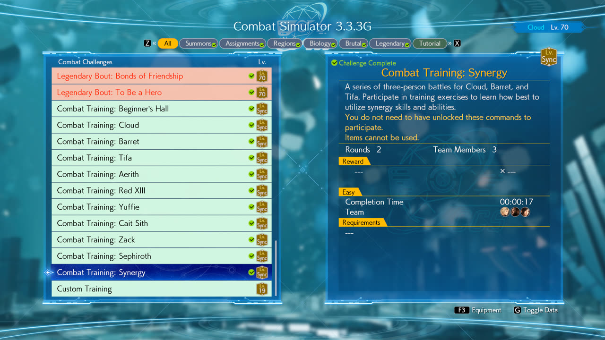
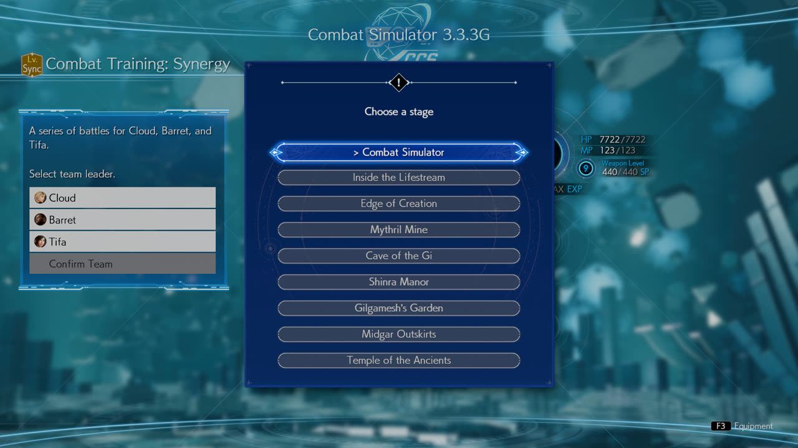
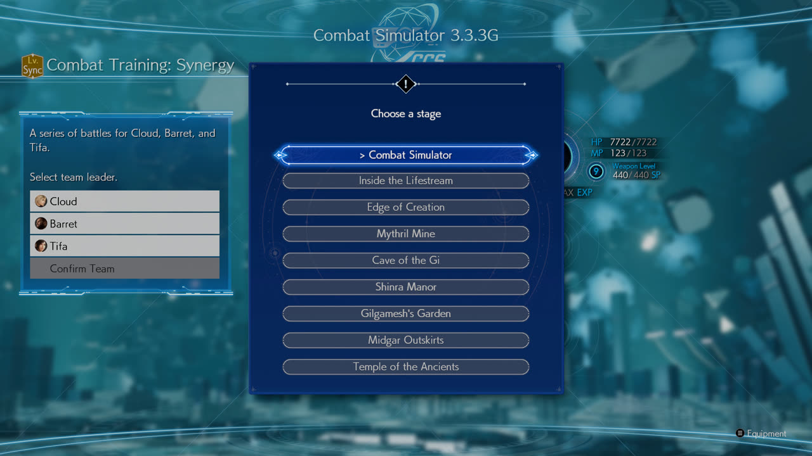
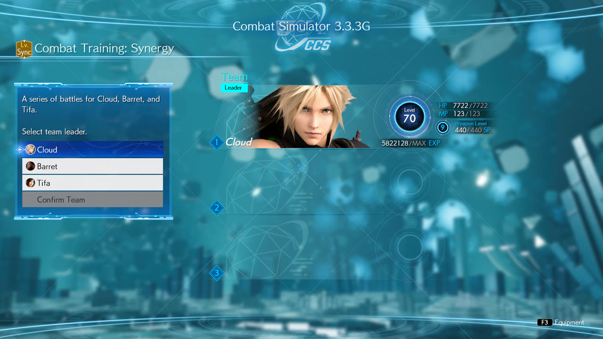
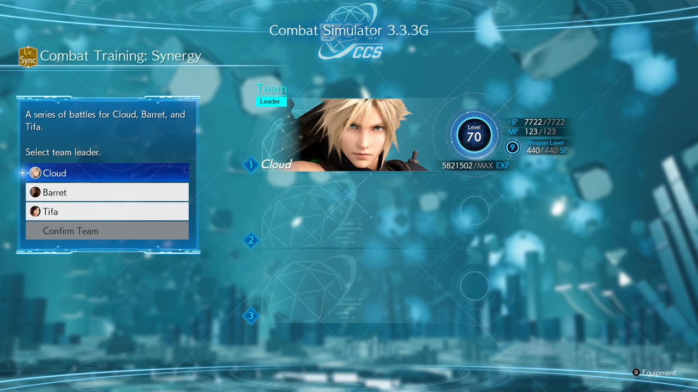
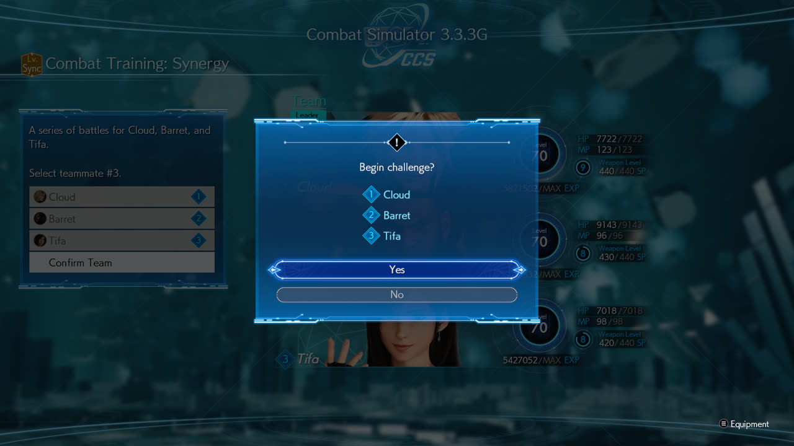
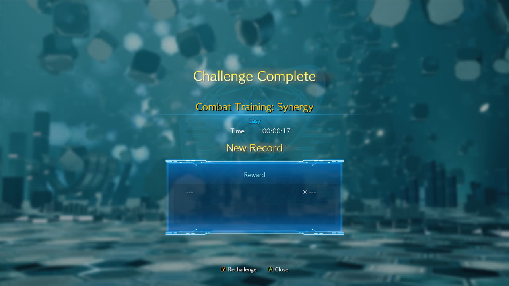
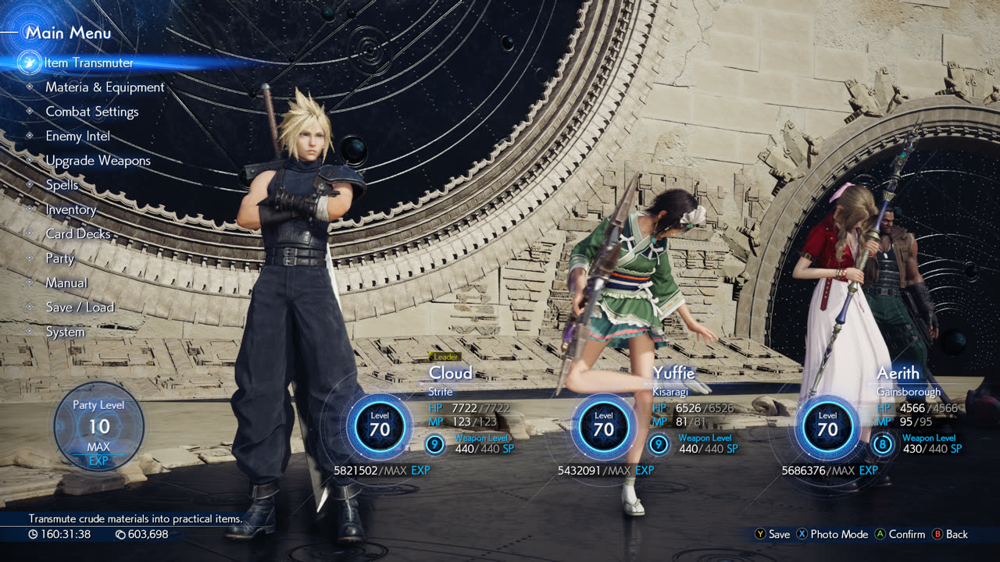
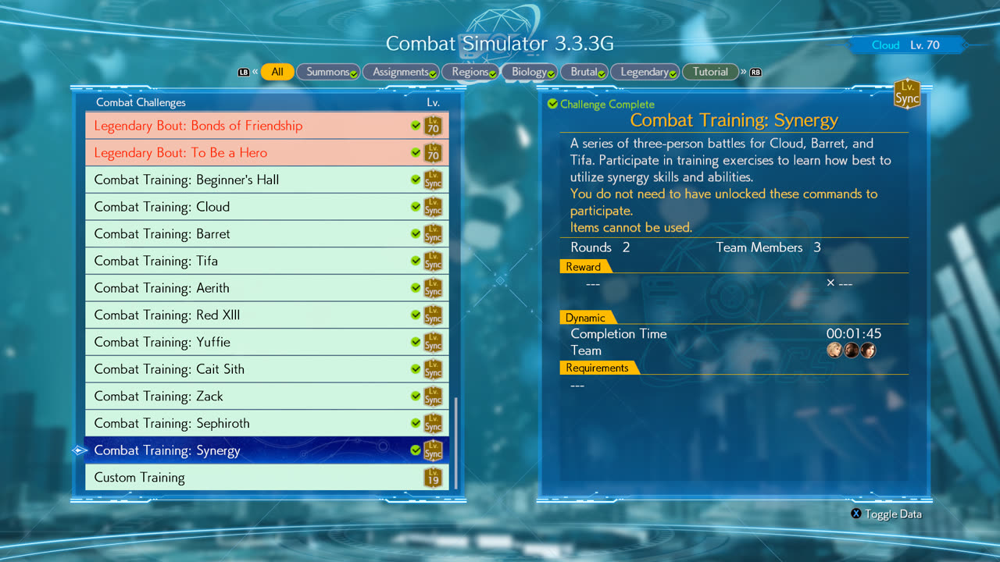

# Workstream: equipment

Changing equipment and materia from Chadley's simulator menus: the course list and the screens after choosing a
course. Never once a course has started (the owner's decision, 2026-11-20 evening; COORDINATION.md fc4826b).

Marks: ✅ seen in game · 🟡 partly · ❌ tried and failed · ⏳ not tried yet

## What the owner will see

Seen 2026-11-21 05:16–05:27 UTC on the **integrated build** (`SimulatorOverhaul`, installed by custom-training from
main 654fc3b, which carries `9d7940d`), save slot 25 at Costa del Sol, driven by the harness's `press_pad` and
`press_key` (real pad and keyboard input through its guards). Screenshots are in `equipment/`.

- **An "Equipment" entry in the simulator's own key guide**, in the game's font, with the game's own button glyph:
  **F3** while the keyboard is in use, the pad's **Start/Menu** button (≡) once the pad is used; it switches by itself
  like the game's own entries. ✅
  - Course list: left of the game's "Toggle Data", same line. ✅ keyboard and pad
  - Every screen after choosing a course (Simulator Stages' stage picker, team screen, "Begin challenge?"): on the
    bottom-right guide line, which the game leaves empty there; clear of the stage picker. ✅ keyboard and pad
  - Gone from "Begin challenge?" Yes on: no entry on Get Ready, in the fight or on the result screen. ✅
  - Back on the course list after a course (the menu is rebuilt then), the entry is back. ✅

  | | Keyboard | Pad |
  | --- | --- | --- |
  | Course list |  |  |
  | Stage picker |  |  |
  | Team screen |  |  |
  | "Begin challenge?" | (same spot as the team screen) |  |
  | After Yes |  Get Ready |  result screen |

- **F3** (keyboard) or **Start** (pad) opens the game's own **main menu** over the simulator: Materia & Equipment,
  Combat Settings, Upgrade Weapons, Spells, Party and the rest, fully usable with either device (it is the game's own
  menu). Back closes it and the simulator screen is exactly where it was.
  - Pad Start ✅ on the course list, stage picker, team screen and "Begin challenge?"; on the course list the pad also
    went down to Materia & Equipment and in with A, and B twice came back to the same highlighted course.
  - Keyboard F3 ✅ on the course list (05:25, Esc back), and earlier on the team screen and "Begin challenge?".
  - "Begin challenge?" keeps Yes highlighted after the menu closes; Back doesn't answer the prompt.

  

- The fight then uses the new gear. ✅ (Cloud's Rune Blade: max HP 7322 in the fight instead of 7722, 2026-11-20.)
- **Not once a course has started**: after "Begin challenge?" Yes the mod reads `started=true`,
  `available=false`; pad Start in the fight and on the result screen opened nothing and the mod logged nothing. ✅
  (05:22–05:23; also 2026-11-20 with F3 and the dev bridge: `status=refused`, `why=course started`.) Back on the course
  list it works again. ✅
- Never in the field: the entry and keys switch off when the simulator's menu goes. ✅

Why the course list is included by default (`equipment_course_flow = course_list`): the owner's point is not having
to leave the simulator, and the course list is where the player decides what to fight next. The menu opens and
closes cleanly there and returns to the same highlighted course, and F3/Start mean nothing else on that screen.
`after_course` keeps the older behaviour (only once a course is chosen); `always`, the older name, is still read.

Notes for testers:

- The harness's `start_and_load_save_slot_async` and `load_save_slot_async` only load with `"execute": true`.
- From the field beside Chadley's machine, `enter_combat_simulator_async` can refuse (`chadley_not_offered`) when a
  second prompt is up; stepping until only `$level_action_operation` shows and using `use_field_action operation`
  opens the course list.
- `press_pad`/`press_key` sometimes read the simulator's screens as field (`field_input_not_requested`); then pass
  `field=true` with a reason, as the harness asks.
- The mod's dev console (`equipment-eval.lua` in the integrated folder: `Mods\SimulatorUpgrade`, or
  `Mods\SimulatorOverhaul` for builds made before the rename) reads the course state (`armed`, `started`,
  `available()`) and the entry's copies (`SimOverhaulEquipmentGuide*`).

## Pad

UE4SS key binds don't see a controller, so the mod reads the pad itself: every 50 ms while the simulator's menu is up
it asks the player controller `APlayerController.IsInputKeyDown(Gamepad_Special_Right)` (Start / Menu / Options),
once per press, the same call Custom Training uses for LB+RB. Start was chosen because it opens this same main menu
everywhere else in the game. `equipment_pad_button` can name another engine key, or `off`.

- ✅ A real Start press (harness `press_pad`, 2026-11-21) opens the main menu on every simulator screen listed above;
  the log shows `key open true` for each, then `closed` when B closes it.
- ✅ **Start does nothing of its own on the simulator's screens.** With the mod switched off on the course list
  (`course:reset()` from the dev console, so the pad poll stops), a real Start press left the screen unchanged: same
  course, no menu, nothing logged.
  
  On the result screen Start did nothing either.
- Inside the main menu the game's own pad controls apply (A, B / Circle back, Start closes it).
- The glyph is the game's `<button=options>` action, which is F3 on the keyboard and Start on the pad. If a player
  rebinds the game's Options key, the glyph follows the game's binding while the mod still listens to
  `equipment_key`; with other keys set in `settings.txt` the entry spells them out instead ("F5 / View  Equipment").

## Interface for the other parts

```lua
local ok, equipment = pcall(require, "equipment.api")
if ok and type(equipment) == "table" and equipment.available() then   -- false while a course runs
    equipment.on_close(function(info)
        -- info.result "closed" | "never_opened" | "failed"; info.stats_changed;
        -- info.battle and info.needs_rebuild are always false now (kept for older callers)
    end)
    equipment.open()            -- on the game thread; returns true, or false and why ("course started", ...)
end
equipment.status()              -- "idle" | "open"
equipment.is_open()
```

`available()` and `open()` refuse while a course runs (after "Begin challenge?" Yes, in any fight). For Custom
Training that means no Equipment entry inside its course; its settings panel should hide the entry when
`available()` is false.

During development the mods are separate Lua states, so `require` fails across them. **Dev bridge:** with `dev.txt`
in `SimOverhaulEquipment`, writing `open` to `SimOverhaulEquipment\equipment-request.txt` (temporary name, then rename)
makes my mod call `api.open()`; the answer comes back in `SimOverhaulEquipment\equipment-result.txt` (`key=value` lines):
`status=open`, then `status=done` with `result`, `stats_changed` (and `battle`, `needs_rebuild`, always false), or
`status=refused` with `why`. ✅ in the field (22:41: `open` then `done`, `result=closed`) and mid-course (23:37:
`refused`, `why=course started`).

## Inside a fight (history; the open question moved to `equipment-midfight`)

Before the owner's decision `open()` also worked inside a fight, on branch `ws/equipment` up to `9036345` (the
research branch `ws/equipment-midfight` starts there):

- ✅ It first opened the fight's own **Paused** window (`ShowPauseMenu(leader, 4)`), then the main menu over it; the
  player picked **Resume** to reach it. The fight stayed held and changes applied at once (max HP 7322 → 7722 after
  swapping to the Buster Sword).
- ❌ **After closing, the fighters stood in a T-pose**: Cloud with no sword after a weapon swap, and Aerith after an
  accessory-only change (Hermes Shoes). Their actor tick, component tick and `bPauseAnims` read normal.
- ❌ The Paused window's **Retry Battle** did nothing in the simulator: the fight went on, still T-posed.
- ✅ **Give Up + Rechallenge** rebuilt the fight with the new gear and normal animation.
- During "Get Ready" between rounds `IsInBattle()` is false; the menu opened over Sephiroth's course, which then ran
  to completion with a black screen (not checked further).
- Giving up and rechallenging from Lua: no clean route found (the tests used the harness's abandon and retry).

## How the game's own main menu is opened from Lua

**✅ `UEndMenuAPI:ShowPauseMenu(leader, 0)` (`EEndMenuPauseMode.Normal`) opens the real main menu**, the one Esc opens
in the field.

**✅ The pause bit must be set by hand.** When Esc opens the menu, the game sets `AEndGameState.GamePause` bit 0
(`EGamePause_SYSTEM`) while it is open. `ShowPauseMenu` alone leaves it at 0, and then closing the menu stalls
half-way (black world or the menu left drawn, input dead). With `GamePause |= 1` right after `ShowPauseMenu`, Back
closes it normally and the game clears the bit itself. `session.lua` also sets it again if it drops while the menu is
up (a fight clears it) and clears it if it lingers after the close.

| Where | Opens | Back returns to |
| --- | --- | --- |
| Field | ✅ | ✅ field |
| Course list | ✅ | ✅ same course highlighted |
| Team screen after choosing a course | ✅ (F3) | ✅ same step; its portrait panel may show the old stats until the cursor moves (Synergy) |
| "Begin challenge?" | ✅ | ✅ prompt, Yes still highlighted; Back doesn't answer the prompt |
| Result screen | ❌ doesn't open (it did clear a stale menu layer) | |
| Inside a fight | see the Custom Training section | |

Other routes tried:

- ❌ `NextPauseMenuKind = 4` (MainMenu) + `SetRequestGamePauseOn(0)`: opens the **Paused** window (Resume / Retry
  Battle / Return to Title Screen), even in the field.
- ❌ `ShowPauseMenu(leader, 0)` + `SetRequestGamePauseOn(0)`: both windows at once.
- ❌ First session, plain `ShowPauseMenu(0)` mid-fight: between rounds it opened, but the fight cleared the pause bit
  and the close stalled; mid-action it showed nothing until the Paused window was opened, and closing left
  `AEndGameState.HideWorld` true. `api.lua` unhides the world after a close if it is still hidden.
- Running `actCmn_ShowMainMenu` from Lua: no reflected entry point.

## Zack and Sephiroth

Their gear can't be changed through these screens, by the game's design: `PlayerTable` marks `pt_Zack` and
`pt_Sephiroth` with `ExcludeEquipmentListFlag = 1` and `ExcludeMateriaListFlag = 1` (every other character 0), so
Materia & Equipment leaves them out. In Sephiroth's training course the main menu opened and listed only Sephiroth
(8000 HP, weapon level 1) as the party ✅; Materia & Equipment itself couldn't be entered there because the harness
refuses menu input during "Get Ready", so his absence from that list is from the table, not yet seen. Their gear in
their courses comes from their own specs. Letting the player change it would need a `PlayerTable` change plus
weapons and materia that exist for them; not attempted.

## Keys, tables, rows

Every key and button this part binds (integration rule 6):

| Key / button | Where it works | What it does | Setting |
| --- | --- | --- | --- |
| **F3** (keyboard) | the simulator's course list and every screen after choosing a course, until "Begin challenge?" Yes | opens the game's main menu | `equipment_key` |
| **Start** / Menu / Options (pad, `Gamepad_Special_Right`) | the same screens | the same | `equipment_pad_button` (`off` turns it off) |

F3 is the menus' Options key (`<button=options>`), and the pad's Options/Start is the same game action. Both are
ignored while any pause menu is open, so inside Materia & Equipment they stay the game's own (Auto-Upgrade Settings).
On the simulator's screens the game does nothing of its own with F3 (seen: the course list and team screen came back
unchanged). No clash with the other parts: Simulator Stages binds F7 on the course list; Custom Training binds F7, G,
View and LB+RB inside its course, where this part is off.

- Settings (the shared `settings.txt`; this part reads only `equipment_` lines): `key`, `pad_button`, `course_flow`
  (course_list | after_course | off), `hint` (on | off). Old `battle_mode`, `hint_x` and `hint_y` lines are ignored.
- Files written (dev installs only, all in the mod folder): `equipment-log.txt`, `equipment-eval.out`,
  `equipment-result.txt`; read: `equipment-eval.lua`, `equipment-request.txt`, and `dev.txt` as the dev marker.
- Integration: the folder comes from `SIM_OVERHAUL_DIR` when the integrated mod sets it; modules live in `equipment/`;
  nothing calls the game in the first 10 seconds after load (the simulator's hooks only fire in play anyway).
- Tables changed: none. Rows added: none. No pak.

## Files

- `ue4ss/SimOverhaulEquipment/Scripts/main.lua`: hooks on `EndColosseumMenu` events, the key, the pad poll, the hint,
  the dev console (`equipment-eval.lua` → `equipment-eval.out`) and the request file.
- `equipment/api.lua` (the interface), `equipment/session.lua` (pause-bit rules, game-free), `equipment/course.lua`
  (when the key works, when a course has started, pad edge detection; game-free), `equipment/settings.lua`, `equipment/game.lua` (every game call), `equipment/hint.lua`.
- `tests/equipment/run_tests.py` (offline, `lupa`), `tools/equipment/Install-Equipment.ps1`: `-Mode Status` shows this
  part inside the integrated mod (`SimulatorUpgrade`, else `SimulatorOverhaul`) and its log; `-Mode Install -Dev`
  installs the standalone development copy only when no integrated mod is installed (both would run), and refuses
  otherwise.
  Install and Uninstall (dry runs with `-WhatIf` too) refuse on the real game folder unless `GAME-LOCK.json` is held
  by `equipment` and refreshed in the last 30 minutes; they only ever write `Mods\SimOverhaulEquipment`.

## Dead ends and lessons

- The simulator's menu widget (`VR_Top_C`) answers `IsInViewport()` **false** while it is on screen; `IsVisible()`
  works. The first build used `IsInViewport` and switched itself off.
- **Drawing the entry.** An `EndTextBlock` built at runtime (`StaticConstructObject` with no template), or a game
  widget made with `WidgetBlueprintLibrary.Create`, is added and reports a size but draws nothing. A copy made with
  the game's own guide text as template, `StaticConstructObject(src:GetClass(), src:GetOuter(), name, 0, 0, false,
  false, src)`, added with `AddChildToCanvas` to that text's live panel, draws exactly like the game's, button tags
  included (`<button=options>`), and switches glyph with the device. The first hint (a plain UMG text, "F3 / Start
  Equipment", placed by `hint_x`/`hint_y`) is gone.
- A `$menu_...` text key resolves only when it is the whole text; mixed with other text it shows as written.
- The simulator's menu (`VR_Top_C`) is built again after each course: the copies are made again for each new menu,
  found once per menu by its path (one `FindAllOf("EndTextBlock")`, about 0.12 s).
- The course list's guide line (`Txt_BtnGuide`) is slid out of view there; "Toggle Data" is `InfoWindow.Txt_Btn`. After
  a course is chosen the info window hides and the guide line shows, empty: one copy per spot, each in view on its
  screens.
- Bug found 2026-11-21 in the probe tests: the entry stayed on Get Ready after "Begin challenge?" Yes, because Yes disarms the
  course and the main loop then stopped ticking. The loop also runs while the entry is shown (`hint.is_shown()`),
  so it is taken down; seen fixed at 05:22 on the integrated build.
- Simulator Stages' eval console can run a half-written probe file (empty chunk, `ok nil`): write to a temporary name
  and rename. My own console has the same rule.
- A probe that read `GetVisibility`/`IsInViewport` on the colosseum widget's children aborted silently.
- The harness refuses menu taps it doesn't expect: `tap` is refused "during loaded gameplay" when it doesn't see a
  menu (Esc via `menu` still works), `battle_menu_tap` needs a fight in progress, and neither works during
  "Get Ready". Its loadout tool can't read this build's save (`loadout_save_unreadable`). Its Rechallenge refuses a
  result screen without a course title (Training Dummy's), and its give-up misses the pause between rounds.
- Force-closing the game from this session was refused by the permission check; the game was restarted by launching
  it with the harness after another session had closed it.
- The harness's give-up (`abandon_combat_simulator_fight_async`) missed again at 23:38 between Synergy's rounds; the
  party won the course by itself. Again at 05:22 on 2026-11-21 (it reported done; the party won).
- After the tests, reloading slot 25 from the field closed the game with no crash dump and no Windows error event;
  cause unknown (this mod was idle in the field at the time).

## Open

- Custom Training: hide its Equipment entry when `available()` is false (always, inside its course).
- Mid-fight changes without the T-pose: `ws/equipment-midfight`.
- The team screen's portrait panel can show pre-change stats until the cursor moves.
- Summon level screen: not reached in these tests (Synergy has no summon step); the entry uses the same guide line.
